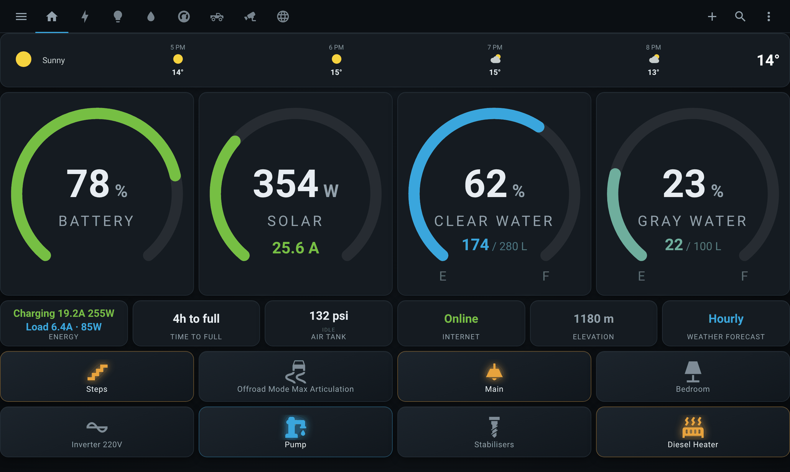
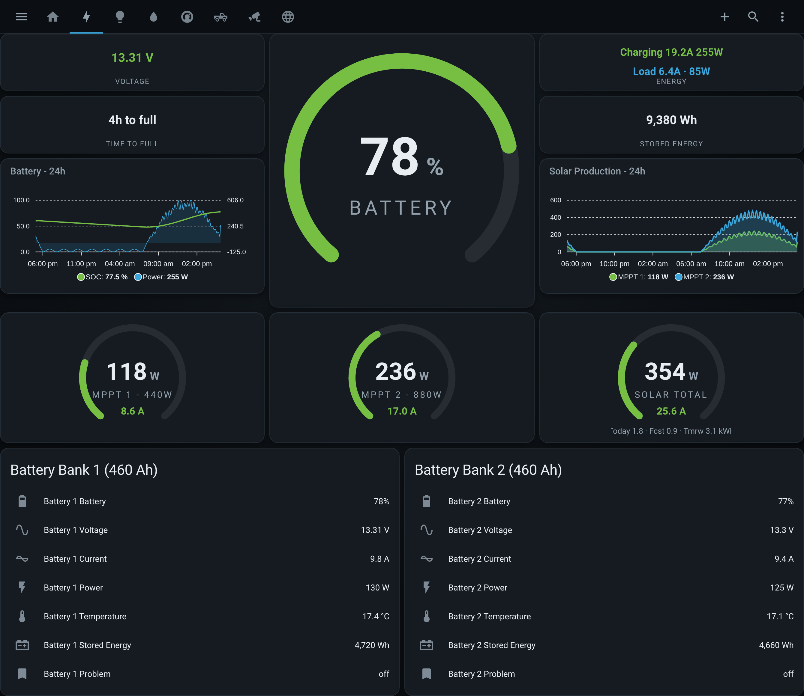
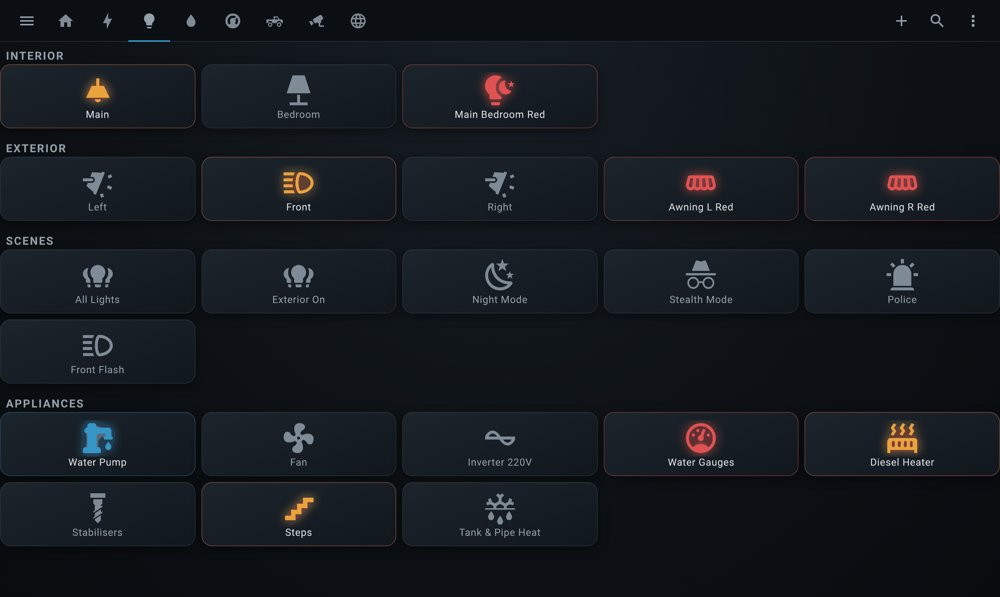
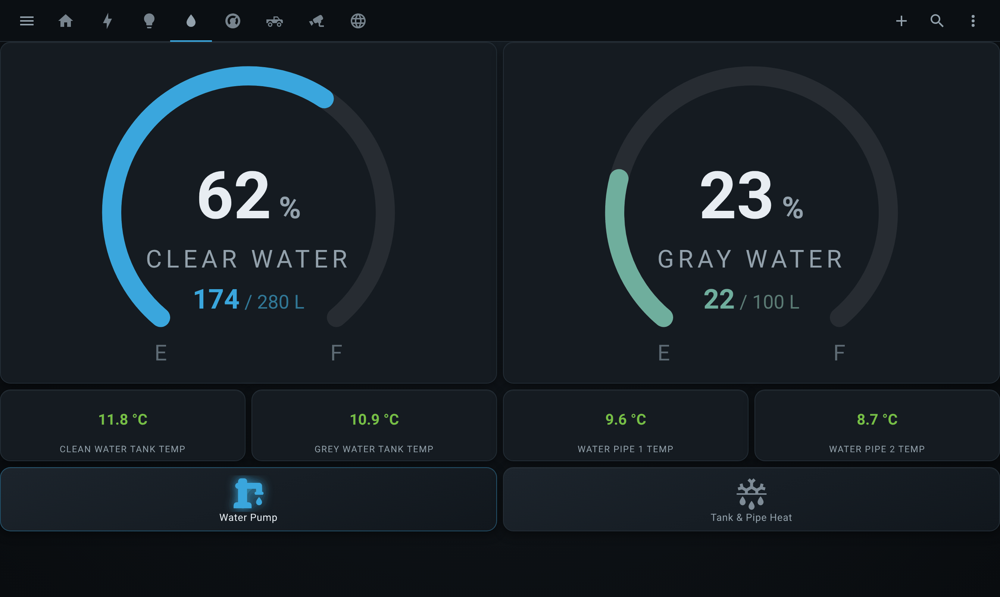
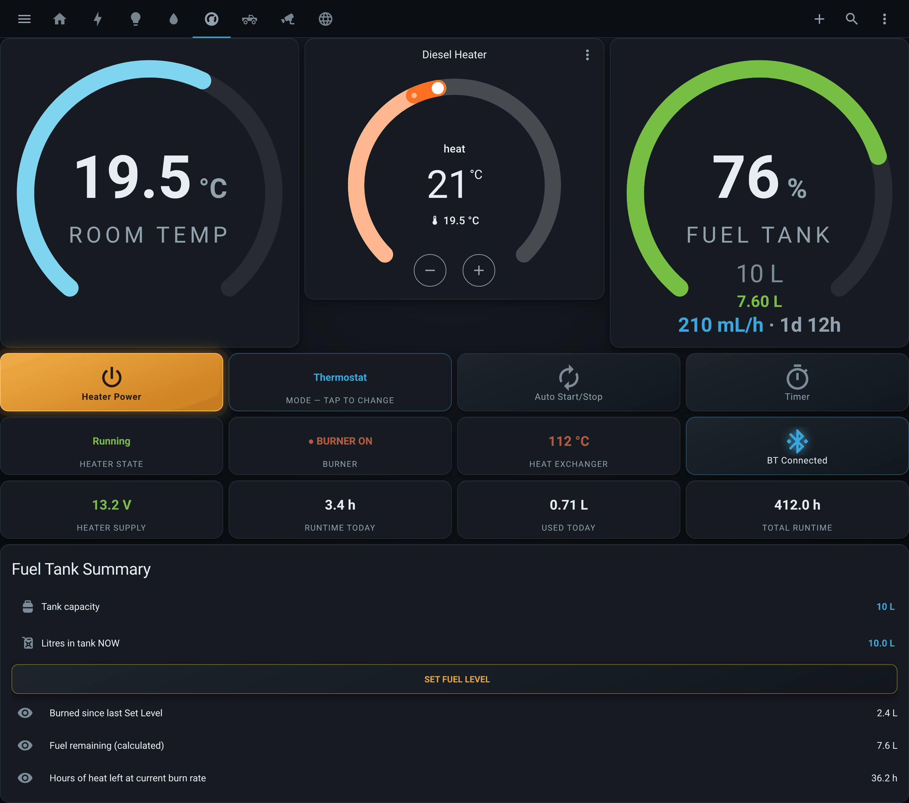
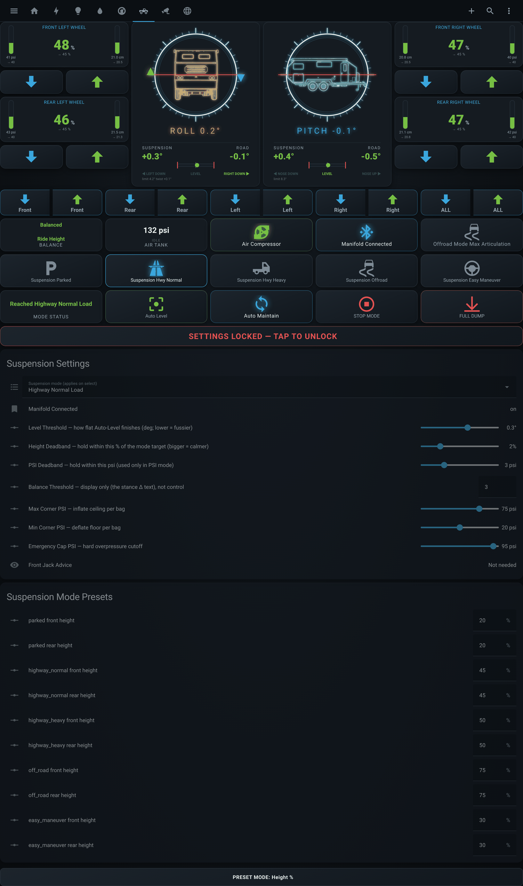
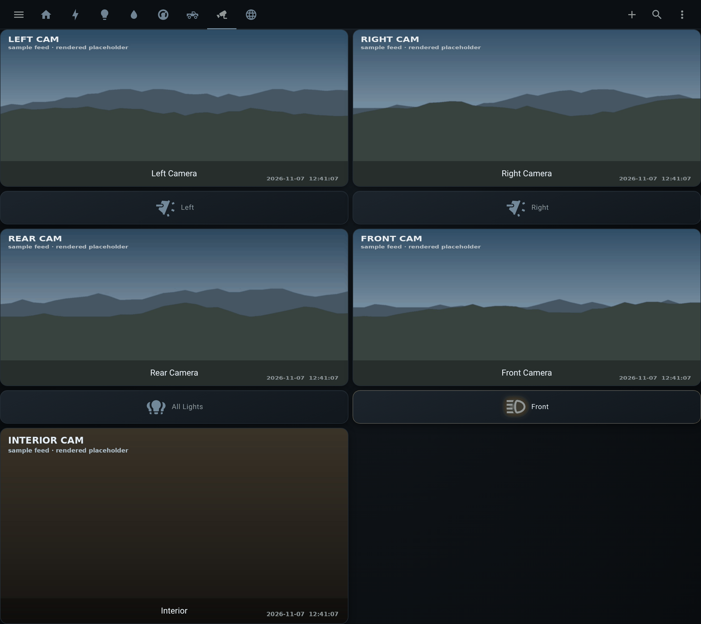
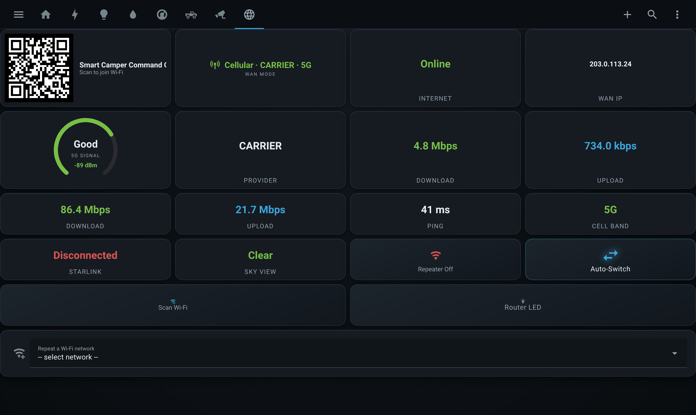
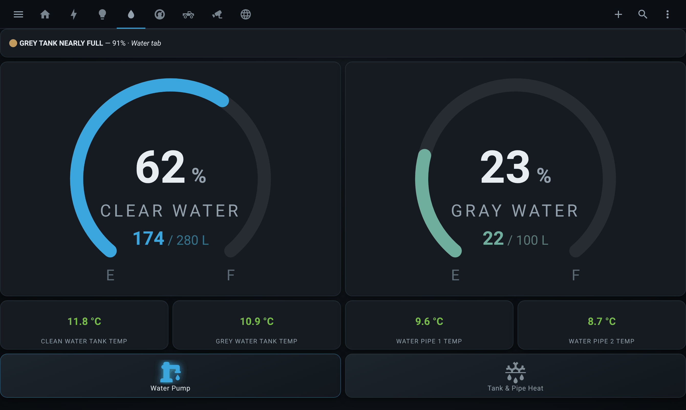
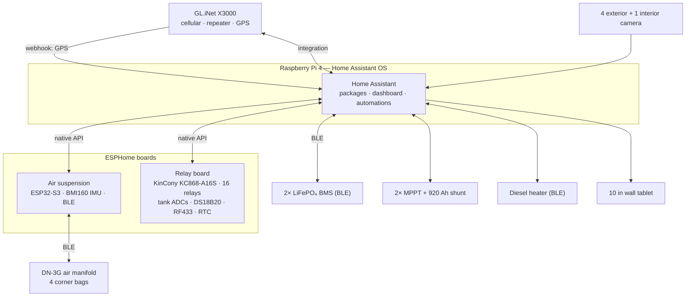

# Smart Camper Command Center

Home Assistant + ESPHome control system for an off-road expedition trailer:

- **Four-corner air suspension** with IMU auto-levelling, five drive modes and
  off-road articulation.
- **16 relay circuits** with physical buttons, an RF433 remote and an RTC
  schedule.
- **Tank metering** in litres, and **freeze monitoring** with four DS18B20
  sensors.
- **Dual LiFePO₄ banks** with shunt fallback, and **1320 W solar** on two MPPTs.
- **Diesel heater** with a virtual fuel tank.
- **Cameras**, plus **cellular / Wi-Fi / Starlink** status, a router **GPS
  tracker** and a 3G watchdog.

It all runs on a dark dashboard built for a 10" wall tablet.

This is the configuration running on a real trailer, published with credentials
and identifying details removed. Every calibration number in the docs says
whether it was **measured**, **derived** or **assumed**.



## Dashboard tabs

| | | |
|---|---|---|
| [](docs/09-dashboard.md#1-home--the-one-glance-status-board) **Home**: at-a-glance status | [](docs/09-dashboard.md#2-energy--battery-and-solar-in-detail) **Energy**: banks, MPPTs, 24 h charts | [](docs/09-dashboard.md#3-lighting--every-relay-grouped-by-where-it-is) **Lighting**: relays, scenes, effects |
| [](docs/09-dashboard.md#4-water--tanks-pump-and-freeze-protection) **Water**: tanks, litres, pipe temperatures | [](docs/09-dashboard.md#5-climate--diesel-heater-and-its-virtual-fuel-tank) **Climate**: heater, virtual fuel tank | [](docs/09-dashboard.md#6-suspension--air-ride-levelling-and-settings) **Suspension**: corners, roll/pitch, modes |
| [](docs/09-dashboard.md#7-cameras--four-sides-and-the-interior) **Cameras**: four sides and the interior | [](docs/09-dashboard.md#8-connectivity--which-link-is-carrying-traffic) **Connectivity**: WAN, signal, Starlink | [](docs/09-dashboard.md) **Global alerts**: shown on every tab |

Screenshots are rendered from this repository's code with demo data (see
[`tools/render-screenshots`](tools/render-screenshots/README.md)), at 1340 × 800 ×2.

## System overview



**The rule:** anything that must still work with the Pi unplugged lives in
firmware: relay buttons, the stabiliser 10-minute cut-off, suspension
closed-loop control, the gauges schedule. Everything else lives in Home
Assistant.

## Documentation

| Doc | Contents |
|---|---|
| [01 — Architecture](docs/01-architecture.md) | How the parts fit, where each decision is made, failure behaviour |
| [02 — Hardware & BOM](docs/02-hardware-bom.md) | Every component and why it was chosen |
| [03 — Integrations](docs/03-integrations.md) | HA integrations, HACS add-ons, custom cards |
| [04 — Air suspension](docs/04-air-suspension.md) | Levelling algorithm, modes, PSI fallback, the sign-error story |
| [05 — Relay board](docs/05-relay-board.md) | Full relay map, timers, interlocks, board quirks |
| [06 — Water tanks](docs/06-water-tanks.md) | Senders, ADC filtering, two calibration scales |
| [07 — Energy](docs/07-energy.md) | BMS, MPPTs, shunt fallback |
| [08 — Connectivity & cameras](docs/08-connectivity-cameras.md) | WAN modes, signal maths, dual-stream cameras |
| [09 — Dashboard](docs/09-dashboard.md) | **Every tab: what it does and why** |
| [10 — Calibration](docs/10-calibration.md) | Tanks, corner heights, IMU, with real data |
| [11 — Safety](docs/11-safety.md) | **Read before building** |
| [12 — Installation](docs/12-installation.md) | From a clone to a working system |
| [13 — Router scripts](docs/13-router-scripts.md) | GPS sender and 3G watchdog on the router |
| [14 — Versioning](docs/14-versioning.md) | Component versions, tags, branching, CI |
| [DN-3G manifold notes](docs/hardware/dn3g-manifold-notes.md) | BLE protocol and valve-side settings |

## Repository layout

```
esphome/
  air-suspension-s3.yaml        ESP32-S3: IMU, BLE to the manifold, levelling
  relay-board.yaml              KC868-A16S: 16 relays, tanks, DS18B20, RF433, RTC
  secrets.yaml.example          copy to secrets.yaml and fill in
homeassistant/
  packages/camper.yaml          templates, alerts, scripts, automations, helpers
  packages/camper_light_effects.yaml   Police / Front Flash effects
  packages/camper_gps.yaml      router GPS webhook → device tracker + sensors
  packages/camper_voice.yaml    spoken suspension announcements
  dashboards/smart-camper-dashboard.yaml   the dashboard (raw YAML)
  themes/garmin_dark.yaml       theme the dashboard is designed against
router/                         GL.iNet scripts: GPS sender, 3G watchdog
docs/                           documentation and screenshots
tools/render-screenshots/       regenerates the screenshots from the code
```

## Versions

Each component is versioned independently, and every version is a commit and a
tag. See [CHANGELOG.md](CHANGELOG.md) and [docs/14-versioning.md](docs/14-versioning.md).

| Component | Current |
|---|---|
| Dashboard | v206 |
| HA package | v58 |
| Relay board firmware | v2.3.8 |
| Air suspension firmware | v5.0.8-S3 |
| Light effects / GPS / 3G watchdog | v2 / v1 / v1 |

## Quick start

The relay map, tank sizes and corner constants describe one trailer, so this
cannot be used unchanged. Read [12 — Installation](docs/12-installation.md). In
short:

1. `cp esphome/secrets.yaml.example esphome/secrets.yaml` and fill it in.
2. Flash `relay-board.yaml` first, then `air-suspension-s3.yaml`.
3. Copy `homeassistant/packages/*` into `config/packages/`.
4. Install `button-card`, `card-mod` and `apexcharts-card` from HACS.
5. Paste the dashboard YAML into a new dashboard's raw editor.
6. **Calibrate before trusting any reading:** [10 — Calibration](docs/10-calibration.md).

## Licence

MIT. See [LICENSE](LICENSE), including the safety notice.
