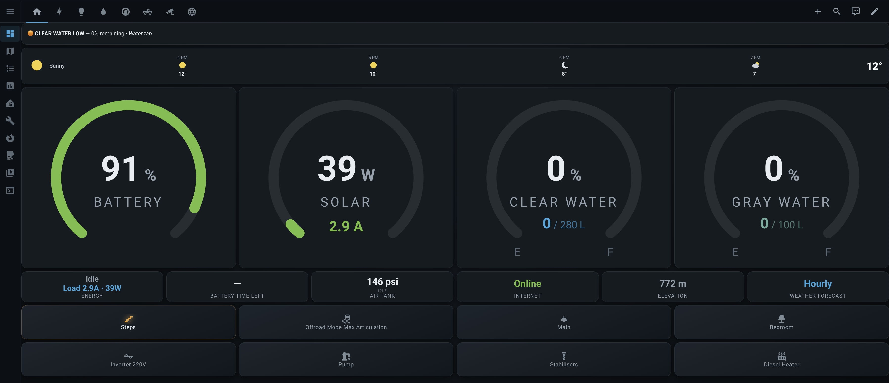
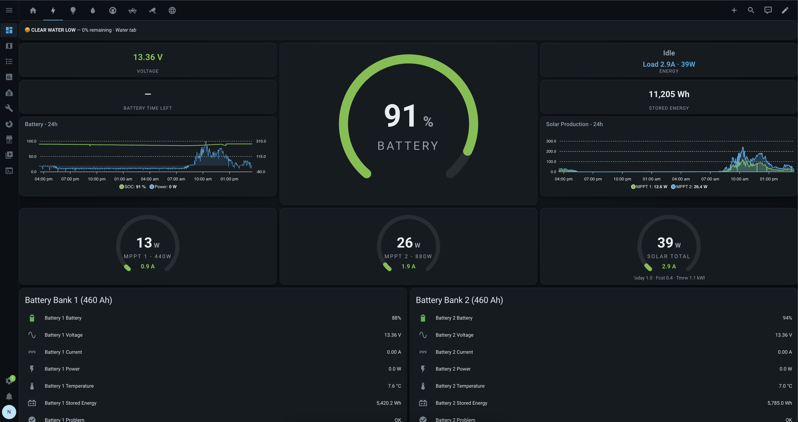
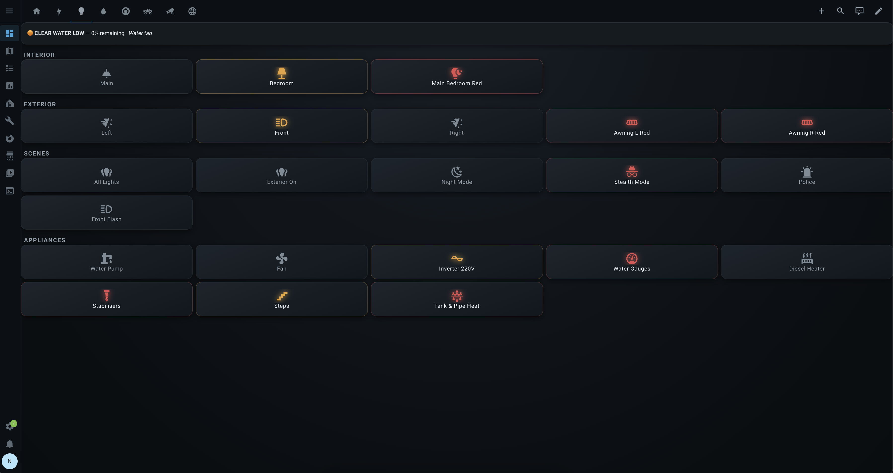
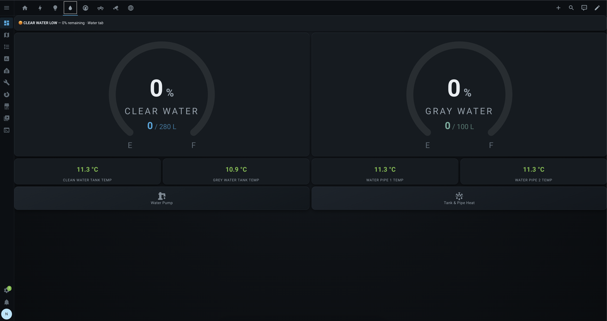
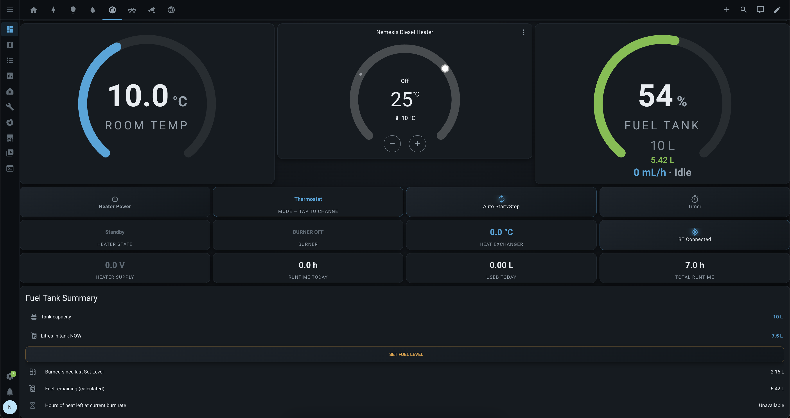
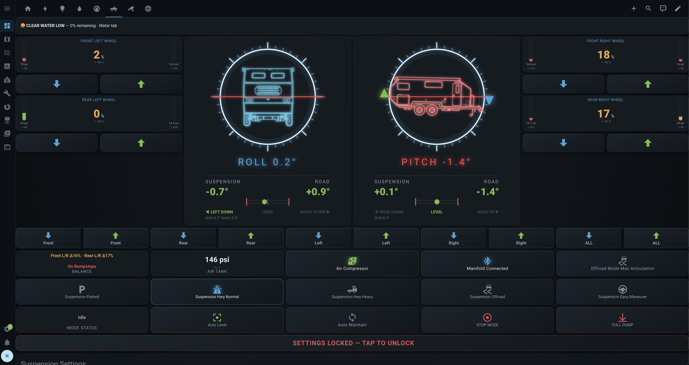
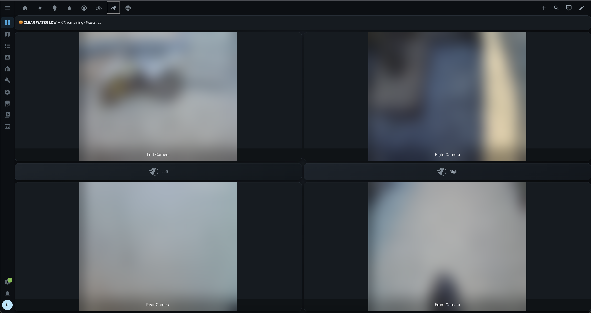
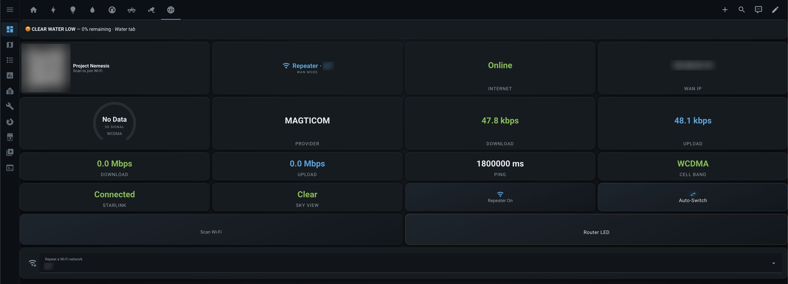
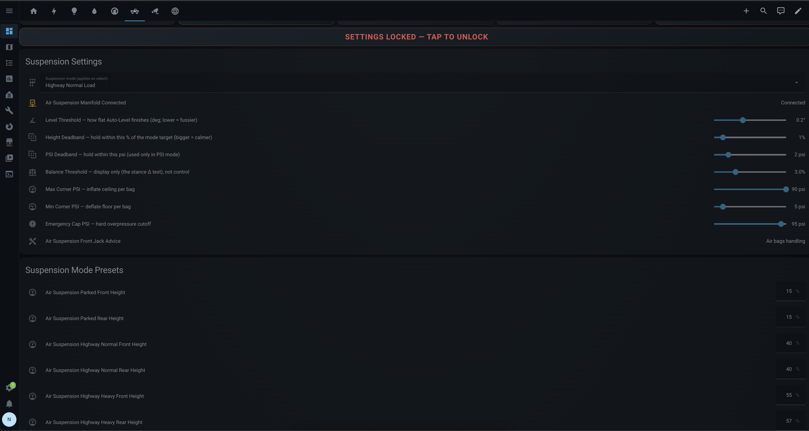
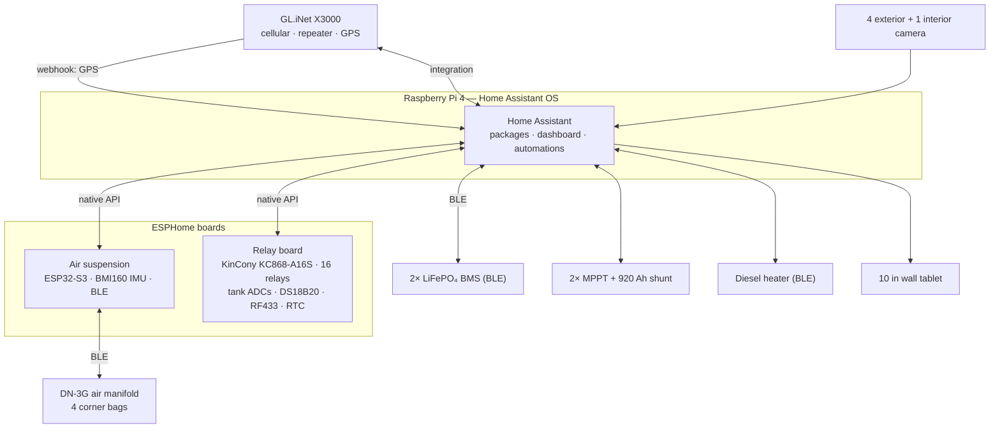

# Smart Camper Command Center

[](https://github.com/ysemenikhin/smart-camper-command-center/actions/workflows/ci.yml)
[](LICENSE)

Home Assistant + ESPHome control system for **Nemesis**, a homemade off-road
expedition trailer (a Bruder EXP-8 replica). Air suspension, power, water,
heating, lighting, cameras and connectivity, in one place.

**Road-tested:** about 7,000 km of towing so far, about 1,000 km of it on heavy
off-road tracks.


## What it solves

A self-built expedition trailer ends up with a separate app for every system:
one for the air suspension manifold, one for the batteries, one for the solar
controllers, one for the heater, one for the router. None of them share data,
none keep history, and none can act on what another one sees.

This project brings all of them into Home Assistant:

- **One central panel:** a wall tablet with the dashboard, physical buttons
  that work on their own, and a backup energy display.
- **History:** every corner height, bag pressure, roll and pitch reading is
  recorded, so the suspension, shocks and air bags are tuned from data instead
  of guesswork.
- **Automation:** ride modes, auto-levelling, auto-maintain, lighting scenes and
  heating run by rules, not by hand.
- **Works without the network:** safety logic and the physical buttons live in
  the ESP32 firmware, so they keep working if Home Assistant, the Raspberry Pi
  or the network is down.

This is the configuration running on the real trailer, tested over about
7,000 km including about 1,000 km of heavy off-road tracks, and published with
credentials and identifying details removed. Every calibration number in the
docs says whether it was **measured**, **derived** or **assumed**.

## Control panel

Three ways to see and control the trailer, each one working on its own:

- **Tablet:** the Home Assistant dashboard (screenshots below). Everything,
  including suspension, cameras and connectivity.
- **Renogy ONE Core:** the backup energy monitor. It shows battery state of
  charge, current, voltage and remaining capacity straight from the Renogy
  devices, so it keeps working when Home Assistant or the Raspberry Pi is down.
- **Buttons:** the physical touch points, wired to the relay board's inputs and
  handled in its firmware. They stay in sync with the relay board: each
  button's ring LED is fed from its relay's output, so it shows the real state
  whether the circuit was switched from the button, the dashboard or the board
  itself.

Also on the panel: the two water tank gauges with their power button, and the
awning rockers with the awning power button. Wiring:
[hardware/wiring.md](hardware/wiring.md).

## What it does, and why

### Air suspension, managed by Home Assistant

The trailer rides on four air bags, one per independent A-frame corner, fed by a
DEPCON DN-3G manifold. Instead of driving it from the manifold's own phone app,
an ESP32-S3 talks to it over Bluetooth and brings it into Home Assistant,
together with an IMU (accelerometer and gyro) and a height sensor at every
corner. That gives:

- **Roll, pitch and road condition**, live and recorded.
- **Control by real suspension position, not by air pressure.** The trailer's
  weight is not spread evenly and it changes with water, gear and people, so the
  same PSI gives a different stance at each corner. The height sensors let you
  set each corner by its actual travel in centimetres.
- **Automatic fallback to pressure.** If a height sensor fails, the firmware
  switches to PSI targets on its own and the dashboard shows a banner, so a dead
  sensor can never make a corner inflate without limit.
- **Ride modes.** Each mode is a set of height targets, plus PSI targets for the
  fallback:

| Mode | When |
|---|---|
| Parked | At camp: levelled, low and stable |
| Highway Normal Load | Towing on the road |
| Highway Heavy Load | Towing loaded |
| Off-Road | Raised, with the articulation valves open so each side's front and rear bags share air and the axles articulate |
| Easy Maneuver | Turning the trailer by hand (below) |

### Auto-level with one button

Park, press **Auto Level**, and the trailer levels itself from the IMU. No
walking around with a spirit level, no blocks: a level bed and a good night's
sleep.

### Auto-maintain

A levelled trailer does not stay level. People move around and sleep on one
side, water moves from the clean tank to the grey tank or out onto the ground,
and the weight distribution changes. **Auto Maintain** keeps watching and
corrects the stance.

### Live roll and travel while towing

On the road, and especially off-road, the dashboard shows live roll, pitch and
each corner's travel. On a steep cross-slope you raise the downhill side to keep
the trailer closer to upright. On a narrow track the same control tilts the
body: the trailer is 3 m tall, so a small tilt moves the roof up to 40 cm to
either side, enough to clear a canyon wall or a tree.

### Easy Maneuver: turn a 3-tonne trailer by hand

One button drops the rear axle to its lowest position, close to 0 psi, and
raises the front axle to its highest. The load moves onto the front axle, the
trailer pivots around it instead of scrubbing all four tyres sideways, and a
3 t expedition trailer can be turned by hand.

### Emergency: tow on three wheels

Each corner is an independent A-frame. If a tyre is lost, that corner can be
held at its lowest position while the other corners raise, lifting the damaged
wheel clear so the trailer can be towed out. Emergency use only: slowly and over
a short distance. Read [11 — Safety](docs/11-safety.md) first.

### 16 relay circuits, scenes and automation

A KinCony KC868-A16S switches the trailer's 12 V circuits: lights, water pump,
fan, inverter, steps, stabilisers, awning lights and the tank gauges. Because
they are all in Home Assistant, they can be automated:

- Switch the front LED bar or the side lights from the truck at night.
- Start the diesel heater ahead of time, so the cabin is at the target
  temperature when you arrive.
- Lights on a schedule or from a motion sensor.
- **Night Mode:** one press for dim red light only, a second press for full
  dark. The button LEDs follow their relays, so the panel goes dark too.
- Scenes: all lights, exterior, stealth (reds only), and police and flash
  effects.

### Energy: monitoring and prediction

Two 460 Ah LiFePO₄ banks, 1320 W of solar on two MPPTs, and a 920 Ah shunt.
Beyond protection, the point is prediction off-grid: energy stored, time left at
the current load, time to full, and today's and tomorrow's solar forecast, so
the stay can be planned around it. If a battery drops off Bluetooth, every
figure switches to the shunt as one coherent source.

### Always online

Connectivity is a must, so there are three independent paths, chosen
automatically by predefined rules, with no need to touch the router:

- **Cellular 3G/4G/5G** on a GL.iNet X3000 with dual SIM, on two different
  carriers.
- **Starlink Mini** for remote places with no cellular coverage.
- **Repeater mode** on the home Wi-Fi when the trailer is parked.

Home Assistant shows which link is actually carrying traffic and tests the
internet end to end. A watchdog pulls the modem back to LTE when it gets stuck
on 3G, and the router's GPS feeds a tracker and the weather location.

### Also

- **Water:** clean and grey tanks in litres, and four temperature sensors on the
  tanks and pipes for freeze monitoring.
- **Diesel heater** over Bluetooth, with a virtual fuel tank that counts the
  litres burned.
- **Cameras:** four sides and the interior, a light sub-stream on the dashboard
  and the full stream on tap.

## Planned

- **GPS drive protection:** when the router's GPS sees the trailer moving and
  the suspension is not in a drive mode, switch to Highway automatically.
  Driving off with the trailer still parked has already happened once.
- **Frigate NVR with a Google Coral AI accelerator:** recording for all cameras,
  smart object detection and a security system.

## Dashboard tabs

| | | |
|---|---|---|
| [](docs/09-dashboard.md#1-home--the-one-glance-status-board) **Home**: at-a-glance status | [](docs/09-dashboard.md#2-energy--battery-and-solar-in-detail) **Energy**: banks, MPPTs, 24 h charts | [](docs/09-dashboard.md#3-lighting--every-relay-grouped-by-where-it-is) **Lighting**: relays, scenes, effects |
| [](docs/09-dashboard.md#4-water--tanks-pump-and-freeze-protection) **Water**: tanks, litres, pipe temperatures | [](docs/09-dashboard.md#5-climate--diesel-heater-and-its-virtual-fuel-tank) **Climate**: heater, virtual fuel tank | [](docs/09-dashboard.md#6-suspension--air-ride-levelling-and-settings) **Suspension**: corners, roll/pitch, modes |
| [](docs/09-dashboard.md#7-cameras--four-sides-and-the-interior) **Cameras**: four sides and the interior | [](docs/09-dashboard.md#8-connectivity--which-link-is-carrying-traffic) **Connectivity**: WAN, signal, Starlink | [](docs/09-dashboard.md#6-suspension--air-ride-levelling-and-settings) **Suspension settings**: behind a lock |

Screenshots are from the running trailer. The Wi-Fi QR code, the WAN IP, the
Wi-Fi network name and the camera images are blurred.

## System overview



**The rule:** anything that must still work with the Pi unplugged lives in
firmware: relay buttons, the stabiliser 10-minute cut-off, suspension
closed-loop control, the gauges schedule. Everything else lives in Home
Assistant.

## Documentation

| Doc | Contents |
|---|---|
| [01 — Architecture](docs/01-architecture.md) | How the parts fit, where each decision is made, failure behaviour |
| [02 — Hardware & BOM](hardware/bom.md) | Every component and why it was chosen |
| [Wiring](hardware/wiring.md) | Front 12 V system cable by cable: fuses, relays, buttons, gauges (PDF + sheets) |
| [03 — Integrations](docs/03-integrations.md) | HA integrations, HACS integrations and cards, add-ons, as running |
| [04 — Air suspension](docs/04-air-suspension.md) | Levelling algorithm, modes, PSI fallback, the sign-error story |
| [05 — Relay board](docs/05-relay-board.md) | Full relay map, timers, interlocks, board quirks |
| [06 — Water tanks](docs/06-water-tanks.md) | Senders, ADC filtering, two calibration scales |
| [07 — Energy](docs/07-energy.md) | BMS, MPPTs, shunt fallback |
| [08 — Connectivity & cameras](docs/08-connectivity-cameras.md) | WAN modes, signal maths, dual-stream cameras |
| [09 — Dashboard](docs/09-dashboard.md) | **Every tab: what it does and why** |
| [10 — Calibration](docs/10-calibration.md) | Tanks, corner heights, IMU, with real data |
| [11 — Safety](docs/11-safety.md) | **Read before building** |
| [12 — Installation](docs/12-installation.md) | From a clone to a working system |
| [13 — Router scripts](docs/13-router-scripts.md) | GPS sender and 3G watchdog on the router |
| [14 — Versioning](docs/14-versioning.md) | Component versions, tags, branching, CI |
| [15 — Troubleshooting](docs/15-troubleshooting.md) | Problems that actually happened, and their fixes |
| [DN-3G manifold notes](hardware/dn3g-manifold-notes.md) | BLE protocol and valve-side settings |

## Repository layout

```
esphome/
  air-suspension-s3.yaml        ESP32-S3: IMU, BLE to the manifold, levelling
  relay-board.yaml              KC868-A16S: 16 relays, tanks, DS18B20, RF433, RTC
  secrets.yaml.example          copy to secrets.yaml and fill in
packages/
  camper.yaml                   templates, alerts, scripts, automations, helpers
  camper_light_effects.yaml     Police / Front Flash effects
  camper_gps.yaml               router GPS webhook → device tracker + sensors
  camper_voice.yaml             spoken suspension announcements
dashboard/
  smart-camper-dashboard.yaml   the dashboard (raw YAML)
themes/
  garmin_dark.yaml              theme the dashboard is designed against
router-scripts/                 GL.iNet scripts: GPS sender, 3G watchdog
docs/                           documentation
hardware/                       BOM, wiring diagram (PDF + sheets), manifold notes
images/                         dashboard screenshots
tools/render-screenshots/       renders demo screenshots from the code
```

## Versions

Each component is versioned independently. See [CHANGELOG.md](CHANGELOG.md) and
[docs/14-versioning.md](docs/14-versioning.md).

| Component | Current |
|---|---|
| Dashboard | v207 |
| HA package | v58 |
| Relay board firmware | v2.3.9 |
| Air suspension firmware | v5.0.8-S3 |
| Light effects / GPS / 3G watchdog / voice | v2 / v1 / v1 / v4 |
| Theme | v4.0 |

Tested on Home Assistant 2026.10.2 and ESPHome 2026.10.2.

## Quick start

The relay map, tank sizes and corner constants describe one trailer, so this
cannot be used unchanged. Read [11 — Safety](docs/11-safety.md) and
[12 — Installation](docs/12-installation.md). In short:

1. `cp esphome/secrets.yaml.example esphome/secrets.yaml` and fill it in.
2. Flash `relay-board.yaml` first, then `air-suspension-s3.yaml`.
3. Copy `packages/*` into `config/packages/` and `themes/garmin_dark.yaml` into
   `config/themes/`.
4. Install `button-card`, `card-mod` and `apexcharts-card` from HACS.
5. Paste `dashboard/smart-camper-dashboard.yaml` into a new dashboard's raw
   editor.
6. **Calibrate before trusting any reading:** [10 — Calibration](docs/10-calibration.md).

Something not working? [15 — Troubleshooting](docs/15-troubleshooting.md).

## Contributing

Fixes, doc improvements and notes from your own build are welcome. See
[CONTRIBUTING.md](CONTRIBUTING.md) and the [Code of Conduct](CODE_OF_CONDUCT.md).
Found a leaked secret or unsafe behaviour? See [SECURITY.md](SECURITY.md).

## Licence

MIT. See [LICENSE](LICENSE), including the safety notice.
