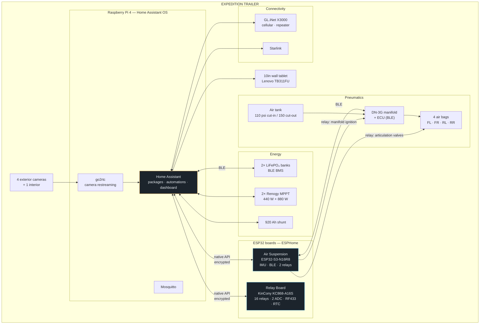
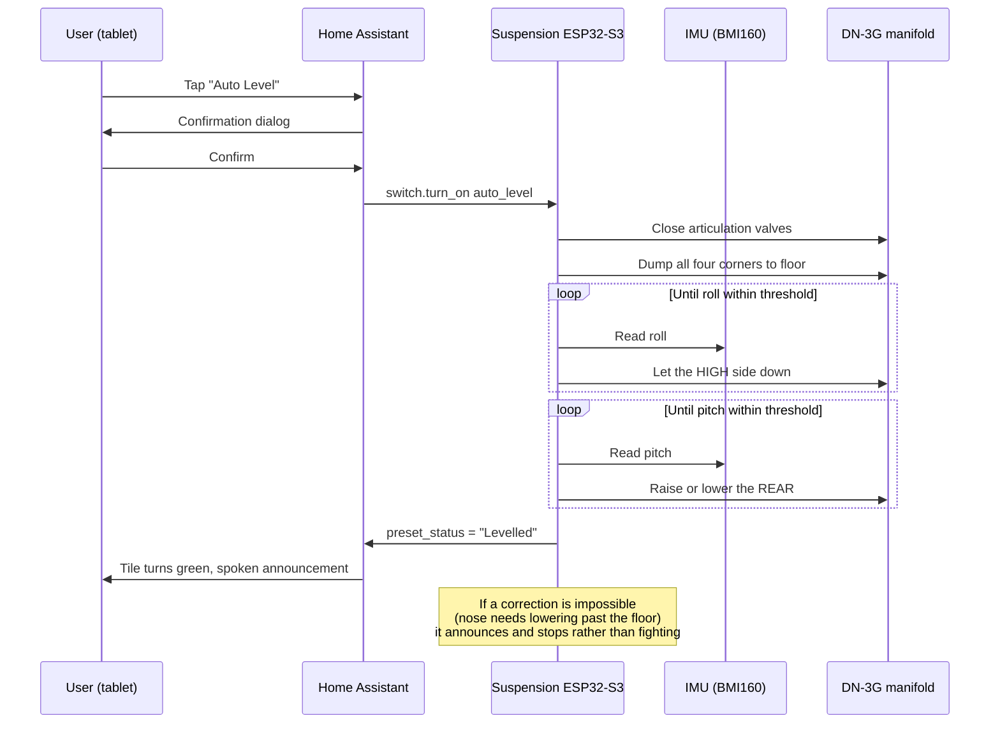

# 01 — Architecture

## The shape of the system

Home Assistant is the brain. Two ESP32 boards are the hands. Nothing
safety-critical depends on a cloud service, and the trailer stays controllable
when there is no internet, no phone signal and no external network at all.

## Where each decision is made

This matters more than the wiring. Putting a decision in the wrong place is how
you get a system that misbehaves when the network hiccups.

| Decision | Lives in | Why there |
|---|---|---|
| Should this relay be on? | **Relay board firmware** | A physical button must work with HA switched off entirely |
| Has the stabiliser circuit been on too long? | **Relay board firmware** | A 10-minute cut-off that depends on the network is not a safety timer |
| Is this corner at its target pressure? | **Suspension firmware** | Closed-loop control at 10 Hz cannot survive network latency |
| Which way is "level"? | **Suspension firmware** | IMU fusion needs to run beside the sensor |
| Which drive mode are we in? | **Suspension firmware** | Targets must survive an HA restart |
| Is the battery low? | **Home Assistant** | Needs data from three sources the boards cannot see |
| Should the gauges be on right now? | **Home Assistant** (schedule) | Convenience, not safety |
| What does the driver see? | **Home Assistant** (dashboard) | Presentation only — never control logic |

**The rule:** anything that must still work with the Pi unplugged goes in
firmware. Everything else goes in Home Assistant.

## Control flow — a levelling run

## Failure behaviour

The system is built to degrade, not collapse.

| What fails | What happens |
|---|---|
| Home Assistant down | Both boards keep running. Physical buttons still switch every relay. Suspension holds its last mode. |
| Network down | Boards raise their own AP. Suspension board's RGB LED goes red. |
| Manifold BLE drops | Suspension reports disconnected; dashboard raises an alert; a power-cycle watchdog is planned via the ignition relay |
| One BMS bank drops | All battery figures switch to the shunt as a coherent set — never a mix of two sources |
| Tank gauges relay off | Tank sensors go **unavailable**, not 0% — a missing reading must never render as a real one |
| A height sensor fails | Suspension latches to PSI-target mode and says so with a banner |
| Cellular drops to 3G | Signal strength reads "No Data" — the router publishes no metric on 3G |

That last column is the design philosophy in miniature: **missing data is shown
as missing.** Several bugs in this project's history were caused by a
`| float(0)` turning an absent reading into a confident zero.

## Next

- [02 — Hardware & BOM](../hardware/bom.md)
- [04 — Air suspension](04-air-suspension.md) for the levelling algorithm in detail
