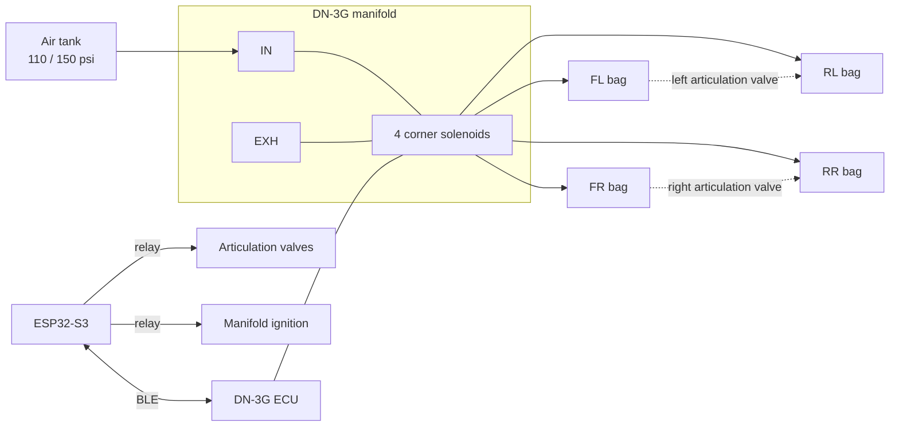
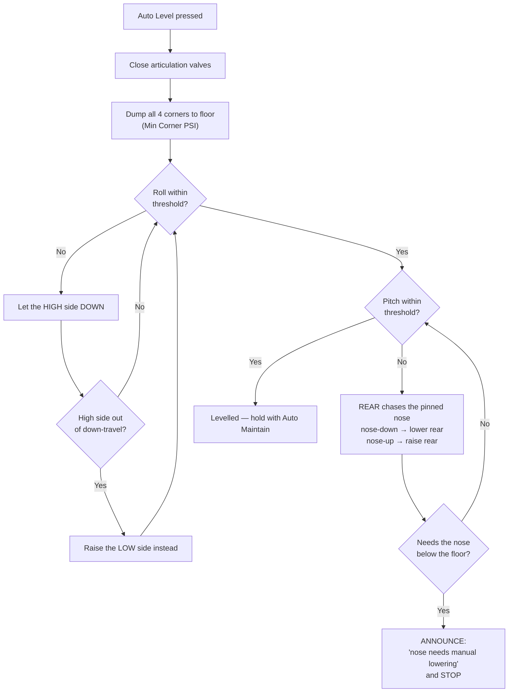

# 04 — Air suspension

The most involved part of the system, and the one with the most hard-won detail.

## Physical arrangement

Four corners, each independent. The two dotted links are **external electric
ball valves**, not part of the manifold — they tie the two bags on one side
together for off-road articulation.

## Why pairs, not corners

A rigid body has three degrees of freedom that matter here: heave, roll and
pitch. Four corners over-determine three degrees of freedom, so driving all four
independently **racks the chassis** — it twists, loading the frame and
potentially lifting a wheel.

So the control rule is:

- **Roll** via side pairs (left two vs right two)
- **Pitch** via axle pairs (front two vs rear two)
- Individual corners only for fine trim and imbalance correction

## The levelling algorithm

This mirrors what an experienced operator does by hand, which is why it works.

Three design choices are worth calling out.

**It dumps to the floor first.** That guarantees raise-room at every corner
before it starts, which makes the routine identical whether the trailer is
coupled or uncoupled — no hitch sensor needed.

**Roll lets the high side down before raising the low side.** Lowering is free;
raising costs air and runs the compressor. Raising is the fallback when the high
side has no down-travel left.

**Pitch treats the nose as pinned.** With a Cruisemaster 360 articulating hitch,
raising the rear works but dumping the front does little — the ball holds the
nose up. So the rear chases the nose rather than the other way round.

When a correction is physically impossible, it **says so and stops**. It does not
sit there fighting its own limits.

### The sign error — worth reading before you trust your own IMU

Auto-levelling did not work for a long time, and the cause was a single
inverted assumption. On this trailer:

- **left-low = NEGATIVE roll**
- **nose-down = NEGATIVE pitch**

The code had assumed positive. With the left side low, it raised the *right*
side — running away to ~96% before hitting limits.

The fix is two comparisons: `low_left = (roll < 0)`, `low_front = (pitch < 0)`.

An earlier attempt added a **runtime polarity auto-flip** that tried to learn the
sign by watching whether things got worse. It was removed, and should not be
re-added:

- It poisoned flash with a learned-wrong value that survived reboots
- Its "getting worse" threshold (0.25°/burst) was coarser than the actual drift
  (~0.2°/burst), so it could not detect the very condition it existed for

Direction is now **deterministic** from the IMU's Invert/Swap calibration.
Verify your own signs by hand, once, and hard-code them.

## Drive modes

| Mode | Use |
|---|---|
| Parked | Levelled, low, stable |
| Highway Normal Load | Road height, normal payload |
| Highway Heavy Load | Road height, loaded |
| Off-Road | Raised, articulation available |
| Easy Maneuver | Low, for hitching and tight spaces |

Each mode holds per-axle **height %** targets, plus a parallel set of **PSI**
targets used by the fallback described below. Changing mode asks for
confirmation — an accidental tap must not drop the trailer.

## PSI fallback

If a height sensor becomes suspect, the firmware latches to PSI-target mode,
holds pressure instead of height, and the dashboard shows a full-width amber
banner saying so. Restoring is manual and deliberate.

This exists because a failed height sensor reading "0%" would otherwise make the
controller inflate that corner indefinitely.

## Compressor vibration

The IMU is wall-mounted on plywood near the compressor, and compressor vibration
jitters the reading. Rather than blocking control while the compressor runs, the
firmware uses **jitter-adaptive fusion**: an EMA of accelerometer jitter raises
the fusion damping, so the symmetric vibration averages out.

A rigid, low, central frame mount would be better. Rubber isolation is the
cheaper fix.

## Corner height calibration

Height sensors report a percentage; the dashboard shows centimetres. Each corner
has its own line, tape-measured:

| Corner | cm from % | R² |
|---|---|---|
| FL | 0.1382 × % + 14.32 | ≥ 0.998 |
| FR | 0.1369 × % + 14.36 | ≥ 0.998 |
| RL | 0.1536 × % + 14.41 | ≥ 0.998 |
| RR | 0.1465 × % + 14.23 | ≥ 0.998 |

RL is noticeably the steepest. Do not assume the four are identical — measure
each. Method in [10 — Calibration](10-calibration.md).

## Settings lock

The suspension settings — pressure limits, deadbands, levelling thresholds — sit
behind a lock, because an accidental brush against a slider changes how the
trailer behaves on the road.

Locked, the sliders are visible but inert (`pointer-events: none`, dimmed).
Unlocking needs a deliberate tap plus a confirmation, shows a live **mm:ss**
countdown, blinks amber throughout, and relocks itself after 5 minutes.

> The countdown is computed **server-side** as a template sensor, not in the
> browser. A browser-side version froze, and read "5:02" on a 5:00 timer because
> the tablet's clock ran ~2 s behind Home Assistant. If you need a live counter
> on a dashboard, compute it where `now()` is authoritative.
