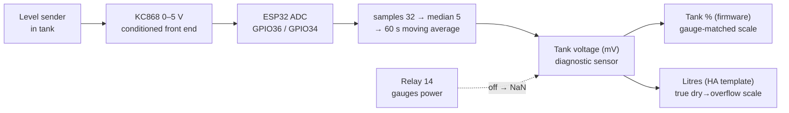

# 06 — Water tanks

Two measured tanks, read as analogue voltages on the relay board.

## Geometry

| Tank | Dimensions | Volume |
|---|---|---|
| Clear A | 114 × 70 × 23 cm | 183.5 L |
| Clear B | 81 × 55 × 23 cm | 102.5 L |
| **Clear total** | | **286 L** (published as 280 L) |
| Grey | 81 × 55 × 23 cm | 102.5 L (published as 100 L) |

All three are rectangular and **all 23 cm deep**, which matters: with constant
cross-section, depth maps linearly to volume. Litres per centimetre:

- Clear (both tanks, interconnected): **12.44 L/cm**
- Grey: **4.46 L/cm**

That linearity is the assumption the whole calibration rests on, and the geometry
supports it. It has been confirmed against the panel gauge but **not yet against
a measured poured volume** — see the caveat in [10 — Calibration](10-calibration.md).

## Signal chain

**Calibrate in board-read millivolts, not multimeter millivolts.** The A16S
analogue inputs are a conditioned 0–5 V front end, so the ADC sees the sender
through an unknown on-board divider. Calibrating against what the board actually
reports removes that unknown instead of trying to model it — and means **no
external divider should be fitted**.

A cross-check on this: the sender's full-scale was predicted at ~2939 mV at the
sender and measured 1450 mV at the board through a roughly 2:1 front end — about
3% agreement, which is as close as this kind of estimate gets.

## Two scales, deliberately

This is the part worth copying, because it solves a conflict most builds just
live with.

The trailer has an **existing panel gauge**, and that gauge is quantised to
**eight steps of 12.5%** — it displays 12, 23, 37, 50, 62, 73, 86, 99 and never
reaches 100 even when the tank is overflowing. Its 0% also sits about 2 cm above
a dry tank.

So there are two different, both-legitimate definitions of "how full":

| Scale | Used by | Meaning |
|---|---|---|
| **Gauge-matched** | The percentage on the dashboard | Agrees with the panel gauge to within 1 point |
| **True contents** | The litres figure | Dry = 0 L, overflowing = full capacity |

They are held as separate calibration numbers:

- Firmware `number.*_tank_empty_mv` / `_full_mv` → drives the **percentage**
- HA `input_number.camper_*_dry_mv` / `_full_mv` → drives the **litres**

Changing one never moves the other. The percentage matches what the owner is used
to seeing; the litres figure is physically honest. Trying to serve both from one
scale is what produces a gauge that is wrong at one end.

> **Do not compute litres as percent × capacity** when the percentage is on the
> gauge-matched scale. At the bottom of the range that understates the clear tank
> by roughly 28 L, because the gauge's zero is not a dry tank.

## Current calibration

| Figure | Value | Confidence |
|---|---|---|
| Clear, gauge scale | empty 258 mV, full 1332 mV | **Derived** from a 7-point fit, ±1 point against the gauge everywhere |
| Clear, overflow | 1318 mV | **Measured**, tank overflowing |
| Clear, dry | 142 mV | **Assumed** — borrowed from the grey sender; the clear tank has never been read dry |
| Grey, dry | 142 mV | **Measured**, corroborated by an independent earlier reading of 140 mV |
| Grey, overflow | 1467 mV | **Extrapolated** from three points stopping at 46% — over half the span unverified |

The sender response is linear: fitting millivolts against gauge percentage gives
`mV = 258 + 10.73 × gauge%` with residuals under ±9 mV across an 820 mV span
(~1%), and that line predicts an independent earlier point (388.9 mV at gauge 12%)
to within 2 mV.

## Sensors produced

| Entity | Unit | Notes |
|---|---|---|
| `sensor.relay_board_clear_tank_voltage` | mV | Diagnostic, the raw input to everything else |
| `sensor.clear_water_tank` | % | Gauge-matched |
| `sensor.clear_water_litres` | L | True contents |
| …and the grey equivalents | | |

All go **unavailable** when the gauges relay is off — never 0.

## Pending

- A **mid-range poured volume** to prove linearity against litres, not just against the gauge
- A dry reading for the clear tank, to replace the assumed 142 mV
- A full fill of the grey tank, to replace the extrapolated 1467 mV
- ~~DS18B20 tank and pipe temperature sensors~~: **done** in relay-board v2.3.0–v2.3.5. Four sensors are shown on the Water tab and drive the freeze-protection decision for RE16.
