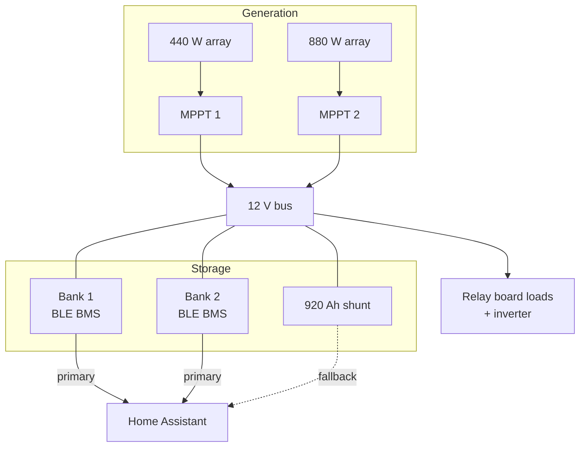

# 07 — Energy

Two LiFePO₄ banks, 1320 W of solar on two MPPTs, and a shunt that exists to catch
the banks when they drop off Bluetooth.

## Sources

## Backup monitor: Renogy ONE Core

The **Renogy ONE Core** display on the front control panel
([photo](../hardware/wiring.md#as-built)) is the backup energy monitor. It talks
to the Renogy devices directly and shows battery state of charge, current,
voltage, remaining capacity and time to full without Home Assistant. If the Pi,
Home Assistant or the network is down, the energy picture is still on the wall.

## The fallback rule

This is the most important design decision in this subsystem.

| Condition | Source used |
|---|---|
| Both BMS banks reporting | **BMS** — current and power summed, voltage and SOC averaged |
| Either bank missing | **920 Ah shunt** for *every* battery figure |
| Both gone | Unavailable |

Recovery is automatic the moment both banks report again.

### Why not "use the surviving bank"

Because current and power are **summed** across the two banks. One bank dropping
off BLE would silently **halve** them while still looking perfectly available —
a wrong number, not a missing one. A 50 A discharge would display as 25 A and
the runtime estimate would double.

Switching the whole set to the shunt keeps **one coherent source** rather than
mixing BMS voltage with shunt current. Mixed sources are how you get a power
figure that is quietly nonsense.

When the fallback is active, the dashboard's alert strip says
`BATTERY ON SHUNT FALLBACK` — degraded operation is visible, not silent.

### What the shunt cannot provide

The shunt lacks two figures the BMS gives directly, so they are derived:

- **Power** = shunt amps × shunt volts
- **Stored energy** = 11 776 Wh × shunt SOC ÷ 100

Both assume the shunt's sign convention matches the BMS (**+ = charging**).

## Solar

Two MPPTs on very different strings. Per MPPT:

- `..._current_solar_watts` — PV input
- `..._solar_charging_ampers` / `_voltage` — string side
- `..._aux_battery_charging_ampers` — DC output to the battery

> Use `current_solar_watts`, not `pv_power`. The Renogy **cloud** integration
> uses the original entity names; a short-lived local-Bluetooth variant used
> different ones and those names are wrong for this setup.

`aux_battery_charging_watts` reads `unknown` on this integration — broken
upstream. Use amps × voltage if you need it.

## Derived figures

| Sensor | Meaning |
|---|---|
| `camper_battery_power` | Signed watts, + = charging |
| `camper_stored_energy` | Wh remaining |
| `camper_runtime_estimate` | Time to empty at current draw |
| `camper_charge_display` | "Charging 12.4 A 168 W" / "Discharging …" / "Idle" |
| `camper_load_current` / `_power` | True draw = solar charge amps − battery amps, clamped ≥ 0 |
| `camper_solar_power` / `_today` | Combined across both MPPTs |

## No smoothing on the live tile (package v58)

The BLE BMS integration polls every **30 s**, a hard-coded `UPDATE_INTERVAL`.
A 15 s moving average on top of that smoothed nothing, because each window held
at most one reading; it only added up to 15 s more delay. v58 removed it. The
tile now reads the bank sum directly and updates on the same 30 s cycle as the
bank cards.

## A trap: charge and discharge disagreeing

At one point the dashboard showed load and discharge as visibly different
numbers over the same period. The cause was that the two figures came from
different sources with different update cadences and sign conventions — not a
measurement error, a *sourcing* error.

If two numbers on your dashboard should agree and do not, suspect that they are
computed from different entities before you suspect the hardware.

## Database churn

Watch sensors that publish raw floats. Two sensors here were generating **12,312
and 10,224 rows per day** simply because the full float changed on every update.
Rounding to a sensible resolution at the source cut that to near zero, because
Home Assistant only writes a row when the state string actually changes.

This matters on a Raspberry Pi running from an SD card or modest SSD.
