# 09 — Dashboard: every tab, what it does and why

Eight tabs, dark theme, built for a 10" wall tablet with a **1340 × 800** usable
area. It is meant to be read at a glance, in daylight, by someone standing
outside the trailer.

> **About the screenshots.** They were produced from the code in this repo, not
> from the real trailer. The dashboard YAML at `dashboard-v206` was loaded into a
> clean Home Assistant install, the entities were filled with demo values
> (`tools/render-screenshots/seed.py`), and each tab was captured headless at
> 1340 × 800 with 2× pixel density, which gives 2680 px wide images. The camera
> feeds and the Wi-Fi QR code are placeholders, and the network figures (IP,
> carrier) are documentation values. To regenerate them, see
> [`tools/render-screenshots/README.md`](../tools/render-screenshots/README.md).

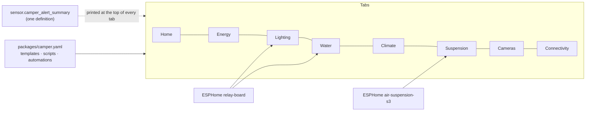

---

## 1. Home — the one-glance status board

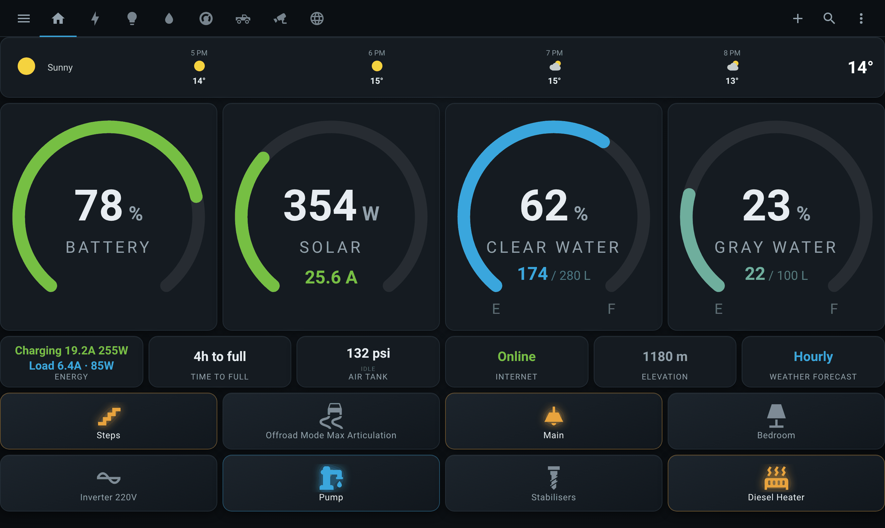

**What it shows**

- **Weather strip:** current conditions plus the next four steps of the forecast
  (`sensor.camper_weather`). The Weather Forecast tile switches it between hourly
  and daily.
- **Four arc gauges:**
  - **Battery SOC:** green above 50 %, amber above 20 %, red at 20 % or below.
  - **Solar:** watts, with combined MPPT charge amps underneath.
  - **Clear water:** % and litres (true contents, not the gauge-matched %).
  - **Grey water:** % and litres.
- **Status row:**
  - **Energy:** "Charging / Discharging A · W", with load A · W underneath.
  - **Time to full / to empty.**
  - **Air tank pressure:** the digits blink while the compressor runs.
  - **Internet:** a real ping test, not router state.
  - **Elevation.**
  - **Weather mode.**
- **Quick tiles:** Steps, Off-road articulation, Main and Bedroom light, Inverter,
  Pump, Stabilisers, Diesel Heater.

**Why it exists**

These are the eight things you check when you walk up to the trailer. The tiles
are the loads you switch most often, so the common jobs don't need a second
tab.

## 2. Energy — battery and solar in detail

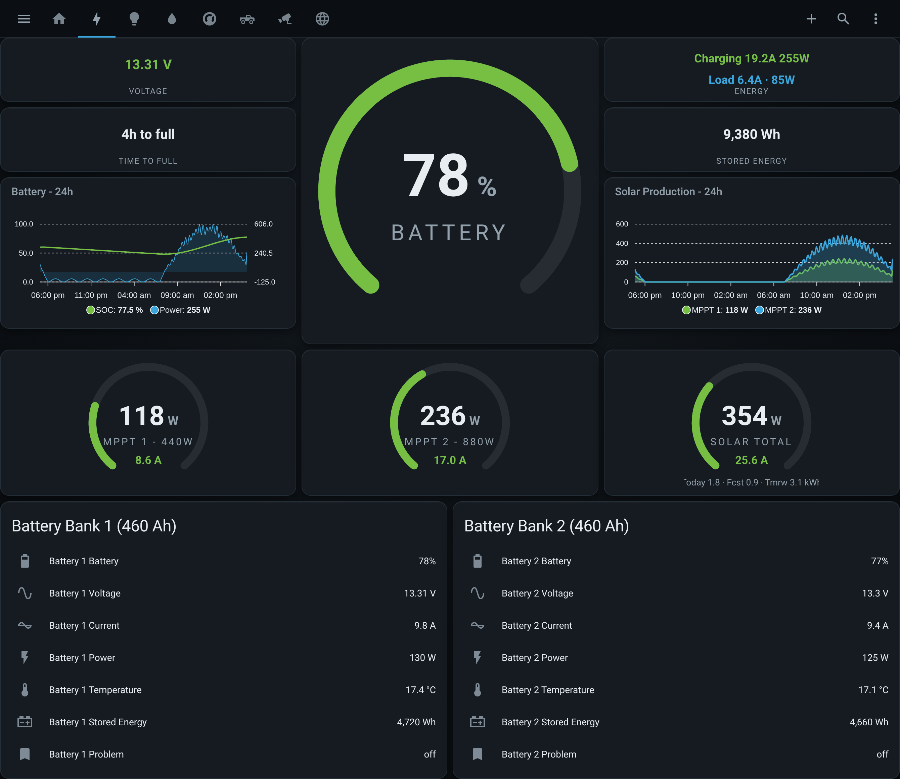

**What it shows**

- **Pack figures:** pack voltage, the charge/discharge line, time-to-full or
  time-to-empty, and stored Wh.
- **Big SOC gauge.**
- **Battery – 24 h chart:** SOC against the left axis, signed battery power as
  an area against the right axis.
- **Solar Production – 24 h chart:** MPPT 1 and MPPT 2 stacked.
- **Three solar gauges:**
  - MPPT 1 (440 W string).
  - MPPT 2 (880 W string).
  - Solar total, with today / remaining forecast / tomorrow.
- **Bank cards:** one per 460 Ah bank, read straight from its BMS. Each shows SOC,
  voltage, current, power (added in v206), temperature, stored energy and the
  BMS problem flag.

**Why it exists**

It shows where the energy goes and whether both banks agree. Per-bank power and
current are the quickest way to see that the banks are sharing load unevenly. If
either BMS drops off Bluetooth, the whole battery set switches to the shunt as
one source, and the alert strip says **BATTERY ON SHUNT FALLBACK**. See
[07 — Energy](07-energy.md).

## 3. Lighting — every relay, grouped by where it is

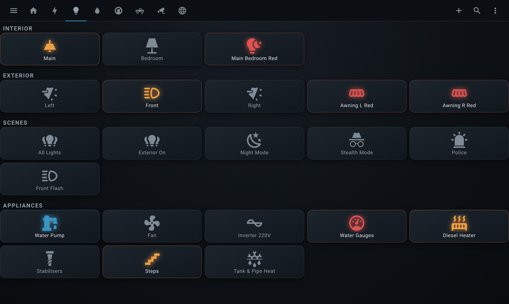

| Group | Tiles | Notes |
|---|---|---|
| Interior | Main, Bedroom, Main Bedroom Red | Red is night-vision safe |
| Exterior | Left, Front, Right, Awning L Red, Awning R Red | Flood spots, LED bar, awning reds |
| Scenes | All Lights, Exterior On, Night Mode, Stealth Mode, Police, Front Flash | Scripts in the package and `camper_light_effects.yaml` |
| Appliances | Water Pump, Fan, Inverter 220V, Water Gauges, Diesel Heater, Stabilisers, Steps, Tank & Pipe Heat | Everything else on the relay board |

**Colour language:**

- **Amber:** white light or an everyday load.
- **Red:** red light, or anything with a consequence (gauges, stabilisers, heating).
- **Blue:** water and air.

A tile lights up when its relay is on, whether it was switched here, from the
physical panel button or from an RF433 fob.

**What the scenes do**

- **Exterior On, Night Mode and Stealth** are toggles: tap once to apply, tap
  again to undo.
- **All Lights** sweeps only the eight lighting relays. It never touches the fan
  or the pump; the v34 bug fix made this explicit.
- **Police** loops white pair → red pair until you tap it again, and always ends
  with all four lights off.
- **Front Flash** flashes the front bar three times and then turns it off.

## 4. Water — tanks, pump and freeze protection

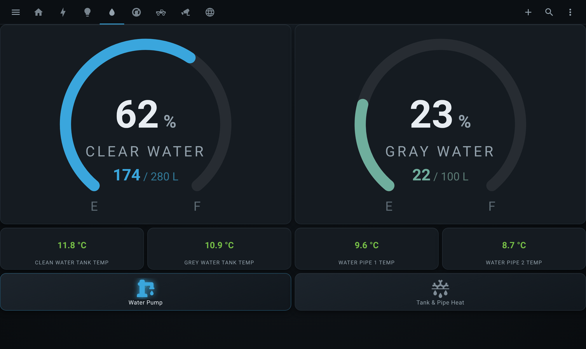

**What it shows**

- **Clear and grey gauges:** % on the scale matched to the panel gauge, litres on
  the true dry-to-overflow scale.
- **Four DS18B20 temperatures:** clean tank, grey tank, pipe 1 and pipe 2. They
  have their own colour bands, so frost stands out.
- **Tiles:** Water Pump and Tank & Pipe Heat.

**Why it exists**

Water is the resource that ends a trip, and frozen pipes are what ends a winter
trip. The temperature row is there to decide when the heat-cable relay (RE16)
needs to come on. When the gauges relay is off (00:00–07:00 by the board's own
schedule), the tank readings go **unavailable**, not 0 %.

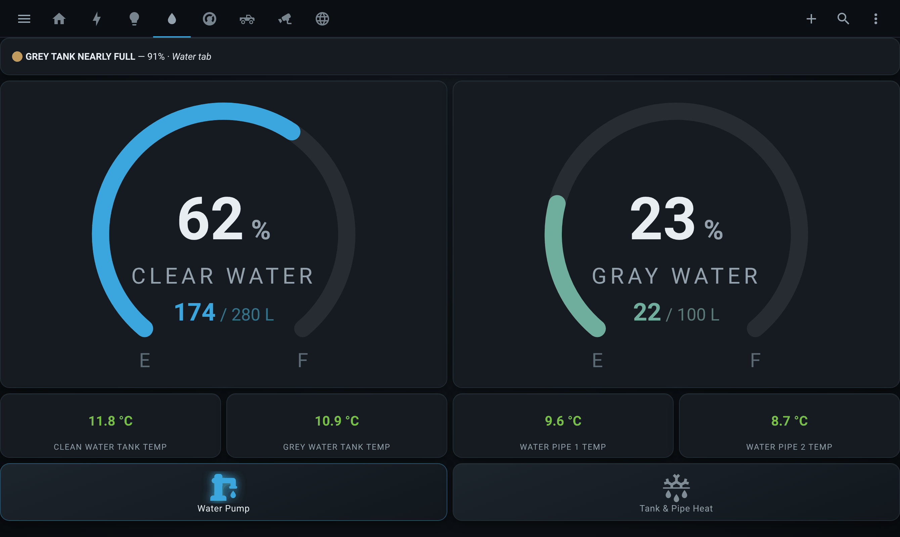

*The same tab with an alert active. The global alert strip appears at the top of
every tab, and takes zero height when nothing is wrong.*

## 5. Climate — diesel heater and its virtual fuel tank

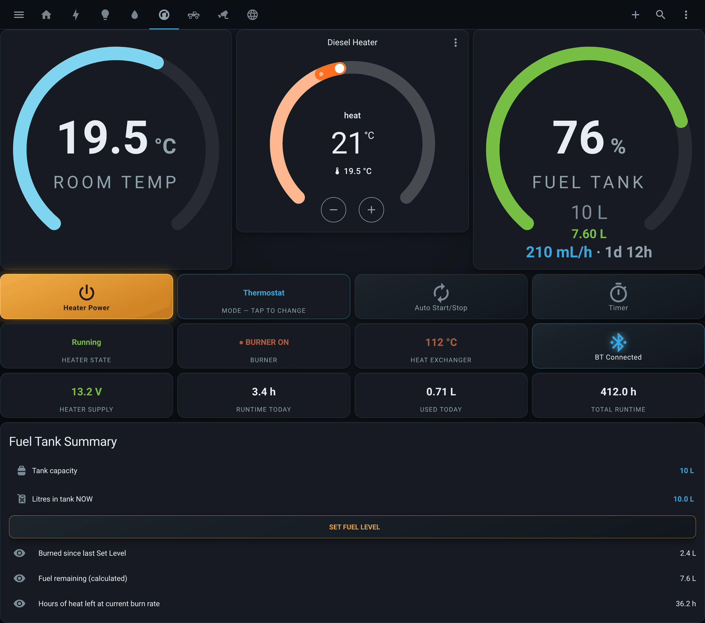

**What it shows**

- **Room temperature.**
- **Thermostat dial,** capped at 36 °C, the heater's own maximum.
- **Fuel tank gauge:** %, litres left, burn rate and heat time left.
- **Control tiles:** Heater Power, Mode (Thermostat / Level), Auto Start/Stop,
  Timer.
- **Live status:** heater state, burner on/off, heat-exchanger temperature,
  Bluetooth link, supply voltage, runtime today, litres used today, total runtime.
- **Fuel Tank Summary:** capacity, litres in tank now, **SET FUEL LEVEL**, burned
  since the last set, and calculated remaining.

**Why it exists**

The heater reports litres consumed but has no level sensor, so the tank is
virtual. After filling, you enter the litres and press Set Fuel Level, and
remaining is worked out as `entered − (consumed_now − snapshot)`. The button asks
for confirmation because it re-baselines the gauge.

## 6. Suspension — air ride, levelling and settings

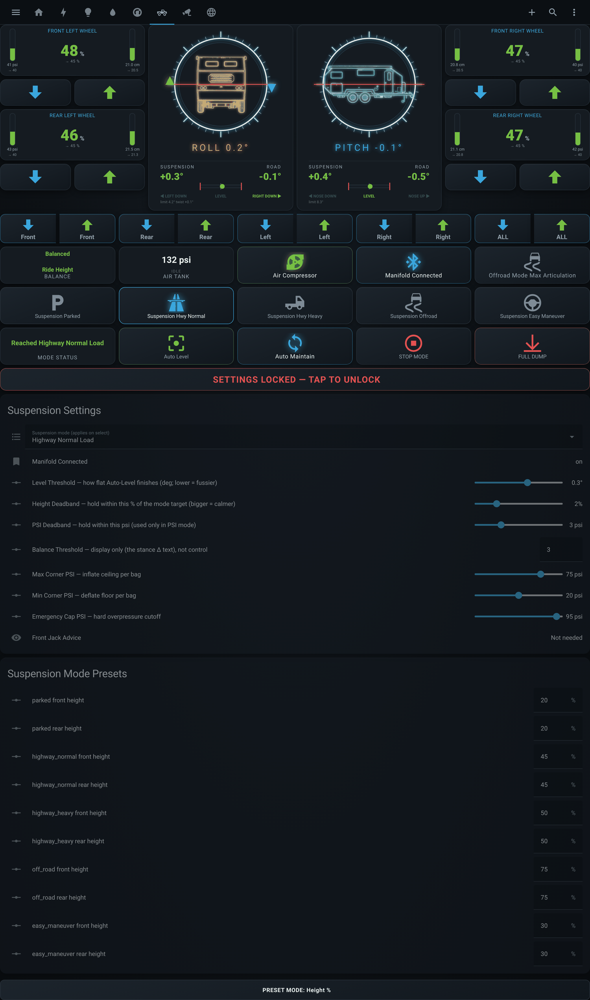

**What it shows, top to bottom**

1. **Four corner boxes:**
   - Pressure and height bars, each with its target underneath.
   - Height in % and cm, with a per-corner calibration line.
   - Raise and lower buttons for each corner.
2. **Roll and pitch dials:**
   - Live IMU angle.
   - It is split into **suspension** (from the four height sensors) and **road**
     (IMU minus suspension), against the geometric limits (≈ 4.2° roll, ≈ 8.3°
     pitch).
3. **Axle, side and all-corner buttons:** Front, Rear, Left, Right and ALL, each
   with raise and lower.
4. **Status row:**
   - Balance and stance text.
   - Air tank psi.
   - Air compressor (manifold power).
   - Manifold BLE link.
   - Off-road articulation valves.
5. **Mode tiles:** Parked, Highway Normal, Highway Heavy, Off-Road and Easy
   Maneuver. Each asks for confirmation.
6. **Actions:** mode status, Auto Level (confirm), Auto Maintain, STOP MODE,
   FULL DUMP.
7. **Settings lock bar,** with the Suspension Settings and Mode Presets cards
   below it.

**Why it exists**

This is the tab used most while travelling, and its history feeds long-term
statistics: the heights and roll/pitch sensors carry `state_class: measurement`.
Anything that changes how the trailer behaves on the road is behind the lock.

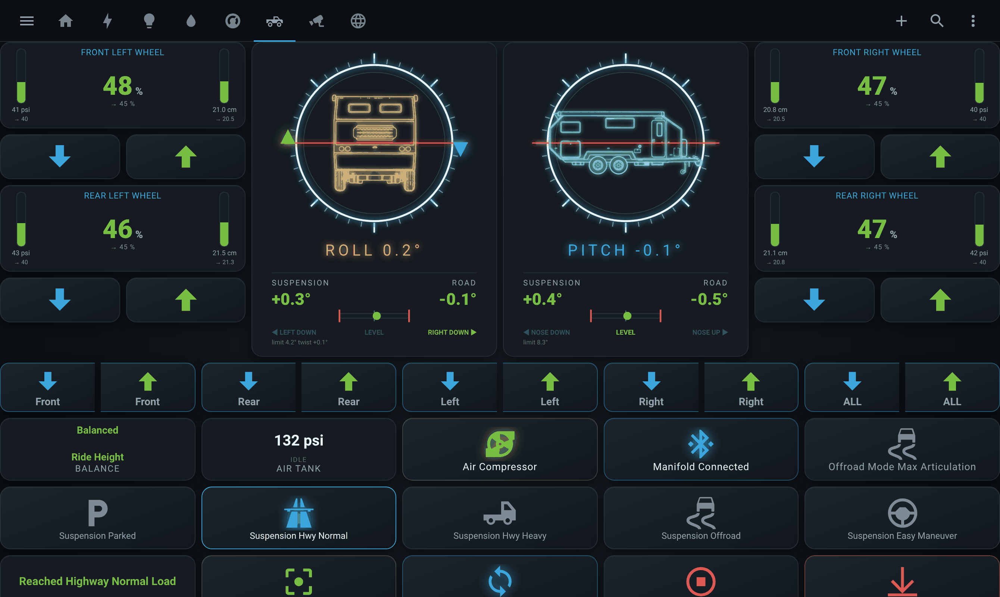

*Unlocked:*

- Unlocking needs a tap and a confirmation.
- The bar shows a **mm:ss countdown** and blinks amber.
- It relocks itself after 5 minutes.
- The countdown is computed on the server, because a browser-side timer froze
  and drifted.

See [04 — Air suspension](04-air-suspension.md) for the levelling algorithm.

## 7. Cameras — four sides and the interior

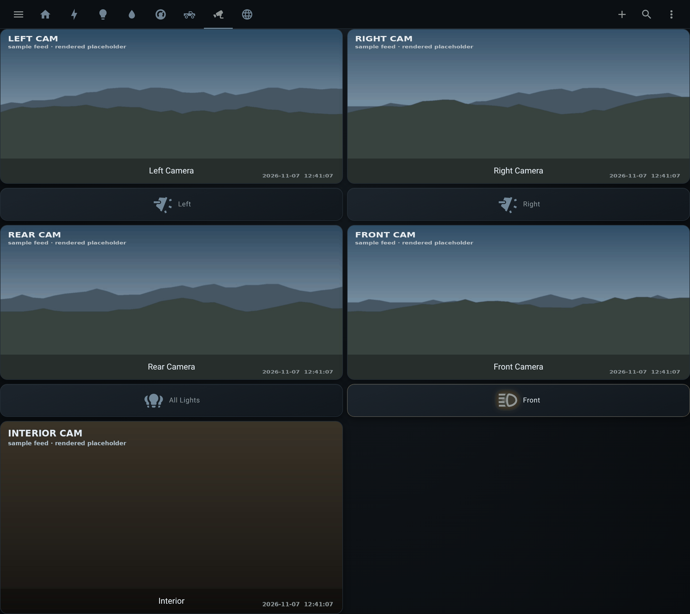

**What it shows**

- **Grid:** Left / Right / Rear / Front in a 2-column grid, plus the interior
  camera.
- **Lights under each feed:** each exterior cell has the light for that view
  directly beneath it. Rear has no light of its own, so it carries an **All
  Lights** toggle.

**Why it exists**

To look before you step out at night, and to light what you are looking at with
one tap. The grid uses each camera's **sub-stream**, so four feeds decode at once
on a tablet; tapping a feed opens its full-resolution stream.

## 8. Connectivity — which link is carrying traffic

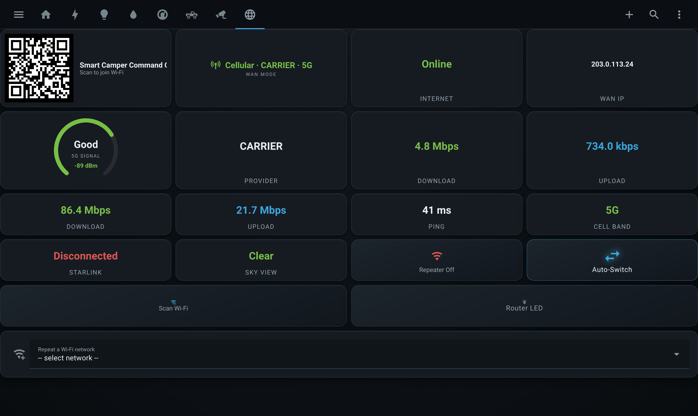

**What it shows**

- **Row 1:** Wi-Fi join QR (a placeholder in this repo), WAN mode, Internet
  (ping), and public IP.
- **Cellular:**
  - Rating gauge from RSRP 70 % / SINR 30 %.
  - Provider.
  - Live download / upload, auto-scaled kbps ↔ Mbps.
- **Speedtest:** download, upload, ping, and cell band.
- **Starlink:** status and sky-view obstruction.
- **Repeater controls:** Repeater on/off, Auto-Switch, Scan Wi-Fi, Router LED, and
  the "repeat a network" picker.

**Why it exists**

The trailer moves between cellular, campsite Wi-Fi and Starlink. This tab
answers "am I online, over what, and how well". On 3G the router publishes no
signal metric, so the rating reads **No Data**, not "Poor". The router-side
`camper-cellwatch` watchdog moves the modem off a stuck 3G cell; see
[13 — Router scripts](13-router-scripts.md).

---

## Card templates

Almost everything is a `custom:button-card` template, so one edit changes every
tile of a kind.

| Template | Used for |
|---|---|
| `panel_button` | Standard toggle tile: icon, name, amber when on |
| `scene_button` | Calls a script instead of toggling |
| `stat_card` | Big value with an uppercase label |
| `arc_gauge` | The circular gauges (battery, solar, tanks, signal, fuel) |
| `corner_stat` | Per-corner suspension box with psi/cm bars |
| `act_button` | Raise / lower / stop actions |
| `manifold_button` | Air compressor, pinned green |

### Two layout traps

1. **button-card pads by a percentage of the card *width*.** A half-width tile
   is about 2.5× wider than a Lighting tile, so the same 4 % eats 2.5× more of
   the fixed 86 px height. The fix (v201) derives the padding from the grid
   maths rather than guessing icon sizes.
2. **`size:` is also a percentage of width.** On wide, short tiles it asks for a
   glyph taller than the card and the icon vanishes. Pin `img_cell` in px
   instead.

## Confirmations

Anything with a physical consequence asks first:

- Auto Level.
- Mode changes.
- Unlocking settings.
- Setting the fuel level.

`entities` card rows cannot carry a confirmation (it is a `tap_action`
feature), which is one reason the settings sliders sit behind a lock.
