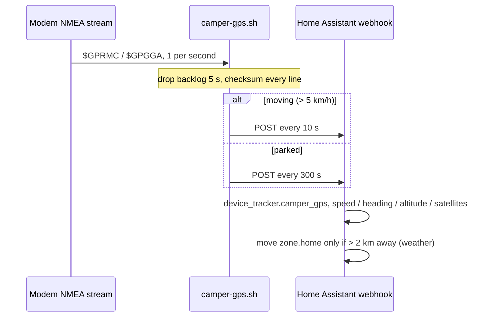
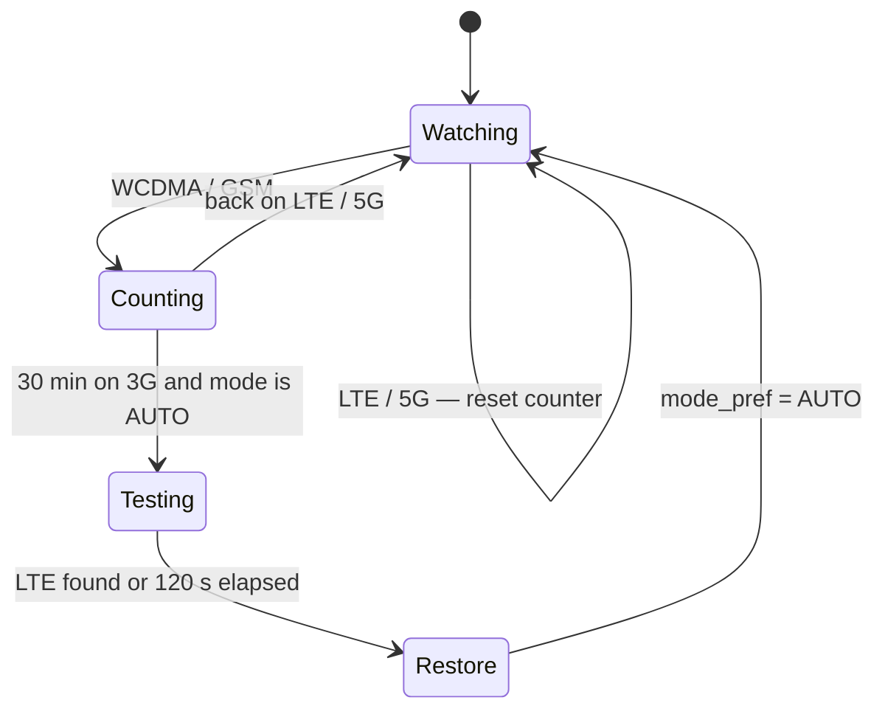

# 13 — Router scripts (GL.iNet X3000)

Two small services run on the router itself, not on Home Assistant. Both are
BusyBox `sh`/`awk` with nothing to install. Each one is started at boot by a
procd init script, which also restarts it if it stops.

| File on the router | Repo path | Purpose |
|---|---|---|
| `/usr/bin/camper-gps.sh` | `router-scripts/usr/bin/camper-gps.sh` | Modem GPS → HA webhook |
| `/etc/init.d/camper-gps` | `router-scripts/etc/init.d/camper-gps` | procd service for the above |
| `/usr/bin/camper-cellwatch.sh` | `router-scripts/usr/bin/camper-cellwatch.sh` | Pulls the modem off a stuck 3G cell |
| `/etc/init.d/camper-cellwatch` | `router-scripts/etc/init.d/camper-cellwatch` | procd service for the above |

Install either pair the same way:

```sh
scp router-scripts/usr/bin/camper-gps.sh   root@<router>:/usr/bin/
scp router-scripts/etc/init.d/camper-gps   root@<router>:/etc/init.d/
ssh root@<router> 'chmod +x /usr/bin/camper-gps.sh /etc/init.d/camper-gps \
                   && /etc/init.d/camper-gps enable && /etc/init.d/camper-gps start'
```

Both scripts support a **dry run** that changes nothing: `DRY=1 /usr/bin/<script>`.
Logs go to `logread -e camper-gps` or `logread -e camper-cellwatch`.

> A router **factory reset or firmware upgrade wipes both**. The GPS sender was
> lost that way once (2026-10-20) and had to be reinstalled.

## GPS sender



- **Only sends with a real fix.** It sends only when the RMC status is `A`, and
  every line is checked against its NMEA checksum.
- **Goes stale on purpose.** The HA side (`packages/camper_gps.yaml`) marks every
  GPS entity **unavailable** after 660 s with no report. Without that, a router
  that stopped sending mid-drive would freeze speed at its last value and write
  it into the statistics.
- **Uses a template device tracker.** `device_tracker.see` is removed in HA
  2027.5, so the package uses a template device tracker instead.

## 3G watchdog (cellwatch)

**The problem.** With the modem on AUTO, it can drop to WCDMA (3G) and stay
there, even with LTE available at the same spot. It doesn't come back because:

- the 3G cell broadcasts no LTE neighbours, so an idle modem never measures LTE;
- cellular is idle (NOCONN) while a Wi-Fi repeater is the WAN, so the network
  never redirects it either.

**What it does.** It checks the serving cell every 60 s. After 30 minutes in a
row on 3G or 2G, it does this:

1. Locks `LTE:NR5G`.
2. Waits up to 120 s for LTE or 5G to register.
3. Puts **AUTO back in every case**, so 3G fallback still works where there is
   only 3G.

It never touches a mode that is not AUTO. If it is stopped mid-test, it restores
AUTO first.



> **Known limitation of v1.** On LTE + 5G NSA, the Quectel modem prints the
> network type on separate `+QENG:` lines. v1 reads only the `servingcell` line
> and logs those periods as "no service". That never triggers a wrong test, but
> the fix (read every `+QENG` line) is planned for v2.
