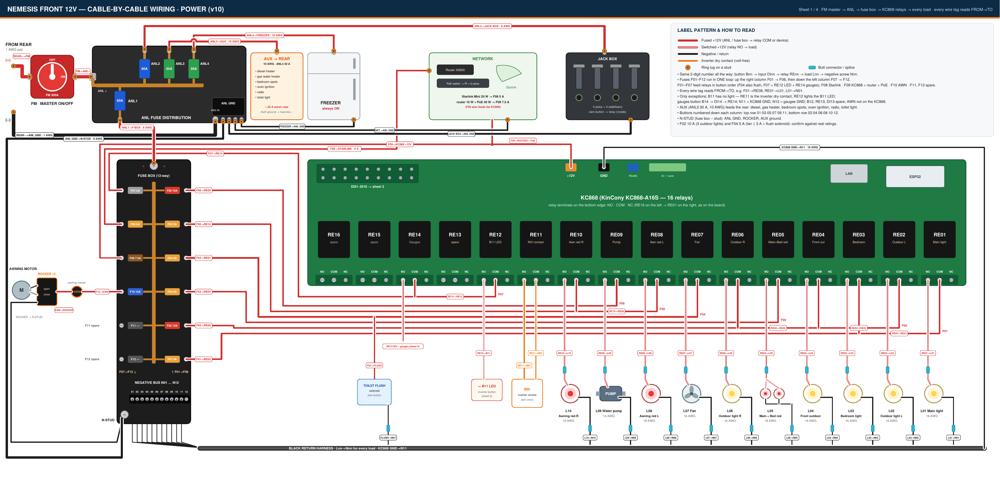
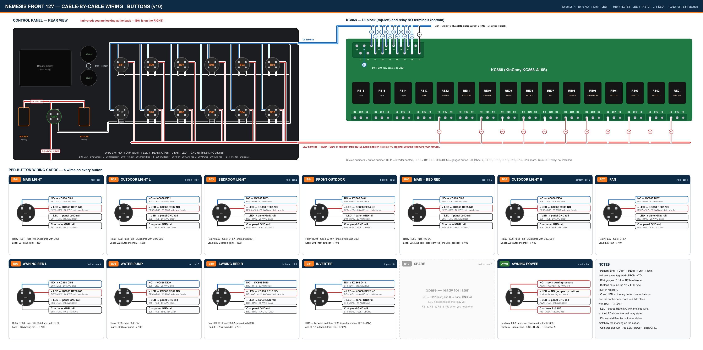
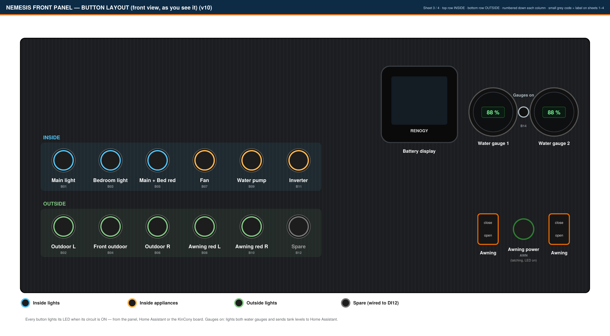
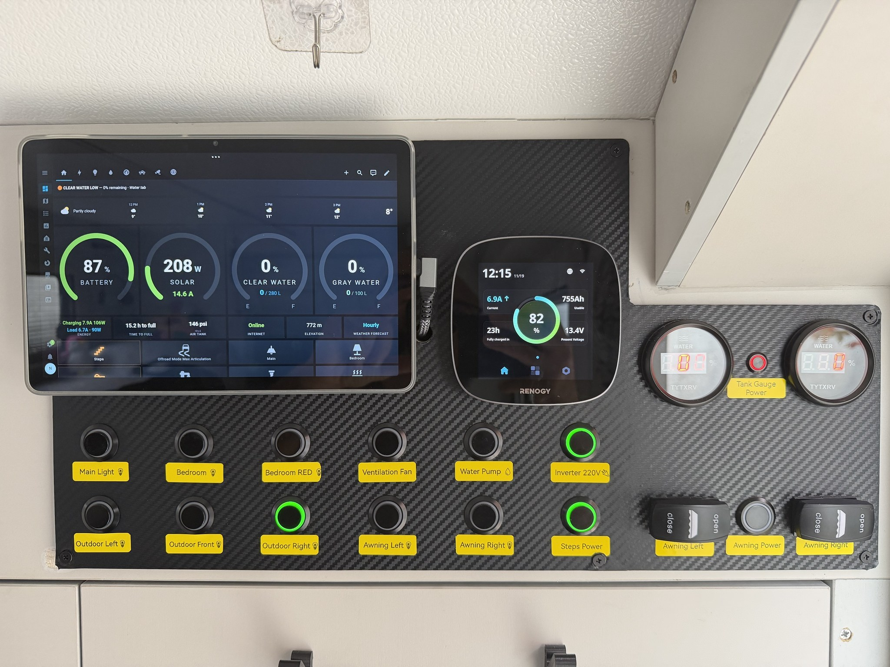
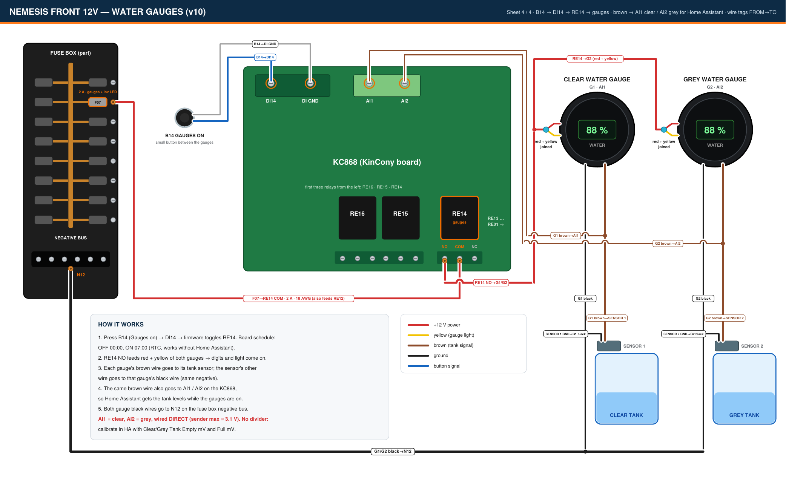

# Wiring — front 12 V system

The front 12 V system drawn cable by cable: battery feed, ANL distribution,
the 12-way fuse box, the KC868-A16S relays, every load, the control panel
buttons and the water gauges.

**Source drawing:** [`wiring/front-12v-cable-by-cable-v10.pdf`](wiring/front-12v-cable-by-cable-v10.pdf)
(4 sheets, v10). The PNGs below are the same sheets, for reading on GitHub.

> **Read [11 — Safety](../docs/11-safety.md) first.** This is a high-current DC
> system: a 300 A master switch and 1 AWG battery cables. Fuse every positive
> cable at its source, and size the cable to the fuse, not to the load.

## How to read the drawing

- **One number all the way through.** Button `Bnn` → KC868 input `DInn` →
  relay `REnn` → load `Lnn` → negative screw `Nnn`. Button B05 drives relay
  RE05, which feeds load L05, which returns on N05.
- **Every wire tag reads FROM→TO**, for example `F01→RE03`, `RE01→L01`,
  `L01→N01`.
- **Colours:** red = fused or switched +12 V, black = negative, blue = button
  signal, orange = the inverter's volt-free dry contact.
- **Exceptions:** B11 (inverter) has no lamp. RE11 is the inverter's dry
  contact and RE12 lights B11's LED. The gauges button is B14 → DI14 → RE14.
  N11 is the KC868 ground and N12 is the gauges' ground.

## Sheet 1 — Power

### Battery feed and ANL distribution

| From → to | Fuse | Cable |
|---|---|---|
| Rear battery + → FM master switch (300 A) | — | 1 AWG pair |
| FM → ANL bus | — | — |
| ANL1 → 12-way fuse box | 60 A | 8 AWG |
| ANL2 → jack box (4 jacks + 4 stabilisers, own button → relay inside) | 60 A | 8 AWG |
| ANL3 → AUX to the rear: diesel heater, gas water heater, bedroom spots, oven ignition, radio, toilet light | 30 A | 10 AWG |
| ANL4 → freezer (always on) | 30 A | 10 AWG |
| Rear battery − → ANL GND | — | 1 AWG |
| ANL GND → N-STUD (fuse box negative stud) | — | 8 AWG |

The N-STUD also takes the AUX ground and the awning rocker ground.

### 12-way fuse box

The fuses run in one loop: up the right column F01 → F06, then down the left
column F07 → F12. F01–F07 feed the relays in button order.

| Fuse | Rating | Feeds |
|---|---|---|
| F01 | 5 A | RE01 Main light, RE03 Bedroom light |
| F02 | 10 A | RE02 Outdoor L, RE04 Front outdoor, RE06 Outdoor R |
| F03 | 5 A | RE05 Main + bed red |
| F04 | 5 A | RE07 Fan, and the toilet flush solenoid |
| F05 | 5 A | RE08 Awning red L, RE10 Awning red R |
| F06 | 10 A | RE09 Water pump |
| F07 | 2 A | RE12 (B11 LED) and RE14 (water gauges) |
| F08 | 5 A | Starlink Mini (≈ 20 W) |
| F09 | 7.5 A | KC868 +12 V, router (≈ 15 W) and PoE switch (≈ 40 W, feeds the Pi and 4 cameras) |
| F10 | 15 A | AWN awning power button → both awning rockers → motor |
| F11 | — | spare |
| F12 | — | spare |

Sheet 1 asks for F02 and F04 to be confirmed against the real loads. Both are
confirmed: F02 10 A for the three outdoor lights, F04 5 A for the fan (≤ 3 A)
plus the flush solenoid.

### Relays and loads

Relay terminals are on the bottom edge of the board: NO · COM · NC, with RE16
on the left and RE01 on the right. Each fuse lands on COM; the load leaves
from NO.

| Relay | Load | Load cable | Return |
|---|---|---|---|
| RE01 | L01 Main light | 16 AWG | N01 |
| RE02 | L02 Outdoor light L | 16 AWG | N02 |
| RE03 | L03 Bedroom light | 16 AWG | N03 |
| RE04 | L04 Front outdoor | 16 AWG | N04 |
| RE05 | L05 Main red + bedroom red (one wire, spliced) | 18 AWG | N05 |
| RE06 | L06 Outdoor light R | 16 AWG | N06 |
| RE07 | L07 Fan | 16 AWG | N07 (toilet flush also returns on N07) |
| RE08 | L08 Awning red L | 18 AWG | N08 |
| RE09 | L09 Water pump | 14 AWG | N09 |
| RE10 | L10 Awning red R | 18 AWG | N10 |
| RE11 | Inverter remote port (volt-free dry contact) | — | — |
| RE12 | B11 inverter button LED | — | — |
| RE13 | spare in the drawing — see [differences](#where-the-drawing-and-the-firmware-differ) | | |
| RE14 | Water gauges (sheet 4) | — | N12 |
| RE15 | spare in the drawing — see [differences](#where-the-drawing-and-the-firmware-differ) | | |
| RE16 | spare in the drawing — see [differences](#where-the-drawing-and-the-firmware-differ) | | |

KC868 ground → N11, 16 AWG.

## Sheet 2 — Buttons

Every button has four wires:

| Button terminal | Goes to | Cable |
|---|---|---|
| NO | KC868 `DInn` | 20 AWG blue |
| LED + | KC868 `REnn` NO, in a twin ferrule with the load wire | 20 AWG red |
| LED − | panel GND rail | 20 AWG black |
| C | panel GND rail | 20 AWG black |

The panel GND rail returns to the KC868 DI GND on one black wire. Because the
LED shares the relay's NO terminal with the load, **the LED shows the real
relay state**, whether the circuit was switched from the panel, from Home
Assistant or by the board itself.

Buttons must be the 12 V LED type with a built-in resistor. Pin layout
differs by model, so match by the markings on the button.

| Button | Function | Input | Relay | Fuse |
|---|---|---|---|---|
| B01 | Main light | DI01 | RE01 | F01 5 A |
| B02 | Outdoor light L | DI02 | RE02 | F02 10 A |
| B03 | Bedroom light | DI03 | RE03 | F01 5 A |
| B04 | Front outdoor | DI04 | RE04 | F02 10 A |
| B05 | Main + bed red | DI05 | RE05 | F03 5 A |
| B06 | Outdoor light R | DI06 | RE06 | F02 10 A |
| B07 | Fan | DI07 | RE07 | F04 5 A |
| B08 | Awning red L | DI08 | RE08 | F05 5 A |
| B09 | Water pump | DI09 | RE09 | F06 10 A |
| B10 | Awning red R | DI10 | RE10 | F05 5 A |
| B11 | Inverter: firmware switches RE11, LED from RE12 | DI11 | RE11 / RE12 | F07 2 A |
| B12 | spare in the drawing (wired to DI12, LED not connected). As built: **Steps Power**, see [differences](#where-the-drawing-and-the-firmware-differ) | DI12 | — | — |
| B14 | Water gauges on/off (sheet 4) | DI14 | RE14 | F07 2 A |
| AWN | Awning power: latching, 20 A rated, **not on the KC868** | — | — | F10 15 A |

## Sheet 3 — Front panel layout

As seen from the front. Top row is inside (B01, B03, B05, B07, B09, B11), bottom
row is outside (B02, B04, B06, B08, B10, B12). Buttons are numbered down each
column. The Renogy battery display, the two water gauges with B14 between them,
and the awning rockers with the AWN button sit to the right.

On sheet 2 the panel is drawn **from the back**, so it is mirrored: B01 is on
the right there.

### As built

Labels on the built panel, from the front:

| | Column 1 | 2 | 3 | 4 | 5 | 6 |
|---|---|---|---|---|---|---|
| **Top (inside)** | B01 Main Light | B03 Bedroom | B05 Bedroom RED | B07 Ventilation Fan | B09 Water Pump | B11 Inverter 220V |
| **Bottom (outside)** | B02 Outdoor Left | B04 Outdoor Front | B06 Outdoor Right | B08 Awning Left | B10 Awning Right | B12 Steps Power |

To the right: the Renogy ONE Core display, the two water gauges with **Tank
Gauge Power** (B14) between them, and the **Awning Left** and **Awning Right**
rockers with **Awning Power** (AWN) between them. The tablet with the Home
Assistant dashboard is mounted on the left.

## Sheet 4 — Water gauges

1. Press B14 → DI14 → the firmware toggles RE14. The board also runs a
   schedule from its RTC (off 00:00, on 07:00), so it works without Home
   Assistant.
2. F07 (2 A, 18 AWG) feeds RE14 COM. RE14 NO feeds red + yellow of both
   gauges, so the digits and backlight come on.
3. Each gauge's brown wire goes to its tank sender, and the sender's other
   wire to that gauge's black wire.
4. The same brown wire goes to the KC868 analogue inputs: **AI1 = clear tank,
   AI2 = grey tank**, wired direct (sender maximum ≈ 3.1 V, no divider). Home
   Assistant reads the tank levels while the gauges are on.
5. Both gauge blacks go to N12.

Calibrate both tanks in Home Assistant with the Empty mV and Full mV numbers;
see [10 — Calibration](../docs/10-calibration.md) and
[06 — Water tanks](../docs/06-water-tanks.md).

## Where the drawing and the firmware differ

Drawing v10 and the relay board firmware
([`esphome/relay-board.yaml`](../esphome/relay-board.yaml), v2.3.9) disagree on
three relays and two inputs. The firmware and the dashboard use them like this:

| | Drawing v10 | Firmware v2.3.9 and dashboard |
|---|---|---|
| RE13 | spare | **Steps**, toggled by B12 through DI12 (since firmware v2.2.0) |
| RE15 | spare (the jack box has its own button and relay, fed from ANL2) | **Stabilisers**: locking switch on DI15, always off at boot, 10-minute auto-off (since v2.1.9) |
| RE16 | spare | **Tank & pipe heater**, reserved |
| DI12 / B12 | spare button, LED not connected | toggles Steps. The built panel matches the firmware: B12 is labelled **Steps Power**, and in the photo its LED is lit while the dashboard shows Steps on. |
| DI15 | spare | Stabilisers switch |
| Free inputs | DI13, DI15, DI16 | DI13, DI16 |

RE01–RE12 and RE14 match. If you build from the drawing, either leave RE13,
RE15 and RE16 unwired or remove those circuits from the firmware. The relay
map and the stabiliser timer are explained in
[05 — Relay board](../docs/05-relay-board.md).
